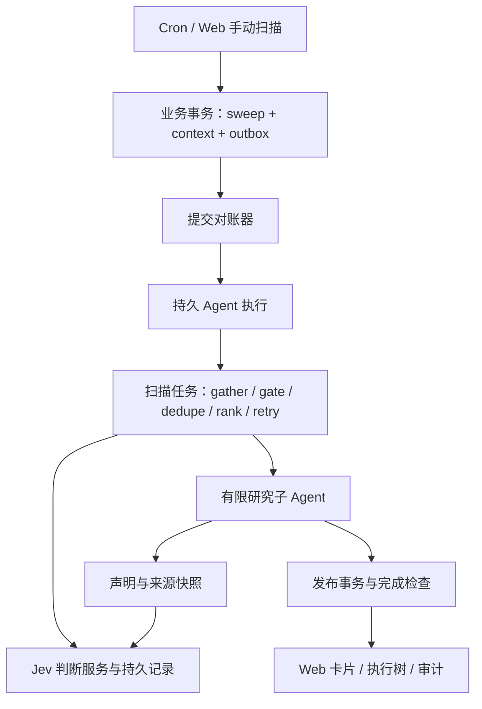

# AgentRadar 开发规格说明书

版本：1.0 · 日期：2026-10-26 · 状态：开发基线，尚未实现和验收

目标仓库：`Hongjian01/pi-durable-news-agent`。源码基线：`273b79bb8d3d8907cae9fbd6abd3da163ee2a343`。

本文是后续开发的规范依据。与 `development-plan.md` 冲突时以本文为准；`development-plan-review.md` 保留为风险证据和设计来源。本文的“必须”是验收要求，“默认值”是首版配置，不代表已测性能或供应商保证。禁止将设计目标写成已取得的简历成果。

## 1. 产品定位与交付边界

AgentRadar 是面向 Agent / 大模型应用开发者的主动技术情报智能体：按计划发现技术更新，利用 Jev 筛选、关联和评分，由研究子 Agent 生成有来源的中文情报卡片，并在进程重启、网络失败后恢复未完成工作。

首要展示三个相互协作的能力：

1. **Durable 执行**：受理、阶段进度、等待重试、研究调用和发布结果具有明确的持久化与恢复边界；通过故障注入验证，而非仅展示定时运行。
2. **Jev 分层判断**：保留 relevance、worth-attention、same-story、importance、hfs、claim-support 六种判断；解释输入、结果、阈值、版本和开销。
3. **受控研究 Agent**：把有限的深度研究预算分配给筛选后的条目；研究结果必须通过证据与业务完成检查才能发布。

首版为单用户、单设备、一个活动扫描，Web 为主要演示入口。默认 8 个信息源、4 个关注主题；首次使用提供可编辑预设。信息源以 GitHub Releases、RSS/Atom、官方更新页为主。来源数量是演示预设，不是产品硬限制。

保留原有 CLI/TUI、工具名称、`@dna/*` 包名、已有 `/v1` 路由和存储目录。首版不重做底层 durable 引擎，不引入向量数据库、消息队列、分布式调度或多 Agent 集群。

不纳入首版：多租户、计费、移动端、自动修改用户项目、自动迁移依赖、自动发邮件、外部平台发布、知识库 RAG、训练分类模型。图片生成、自动发现来源、付费深度抓取默认关闭；可保留上游实现，但不得成为主流程验收前提。

## 2. 继承、改造与个人贡献

继承：Pi Agent 运行封装、原有 durable task / memo / 子 Agent 基础、Cron、工具体系、Web 执行树及 HFS 产品结构。

必须新增或修复：

- 提交意图 outbox 与业务库/执行库对账。
- 可信进展检测、取消与迟到写入隔离。
- 逐判断重试、错误与否定答案分离、无新闻与处理失败分离。
- 数据库级条目发布幂等与可恢复完成检查。
- 评估上下文快照、版本化判断记录和缓存。
- 中文事件候选召回、逐声明证据绑定。
- 持久预算、可解释成本与三组对照评测。

仓库保留 LICENSE 和第三方来源说明；README 区分继承能力与新增实现。项目品牌、中文交互、功能取舍和个人提交形成自己的产品，不通过删除许可或改名冒充底层引擎原创。

## 3. 总体架构与信任边界



业务数据在 `dna.sqlite`；运行状态在 `agent.sqlite`。两个数据库之间没有原子事务，不假设跨库 exactly-once。系统目标是：可重复提交和恢复、本地业务副作用幂等、外部请求重复可记录且受预算限制。

原始扫描持久任务只负责 `gather/gate/dedupe/rank/retry`；后续研究、HFS、报告、发布由 Agent 工具协作完成。保留此结构，在工具和业务存储边界补强约束，不把所有步骤重新实现为另一套工作流引擎。

模型输出、网页内容和工具自然语言报告均不能直接决定业务终态。终态由服务端基于持久业务记录计算。Telemetry 是展示与诊断投影，不能充当运行状态或已完成业务的唯一依据。

## 4. 核心不变量

- **INV-01**：同一 `requestId` 只对应一个 sweep；接受记录与提交意图在同一业务事务提交。
- **INV-02**：同一设备至多一个活动 sweep；请求去重和活动位占用在同一写事务内完成。
- **INV-03**：恢复已接受任务时使用原始输入、评估上下文与稳定提交标识，不静默套用最新偏好。
- **INV-04**：进程重启不增加执行代次；取消/隔离旧执行才增加代次。旧代次不得产生新的业务副作用。
- **INV-05**：供应商异常不能转换为“无关”“不值得关注”“声明不成立”或“没有新闻”。
- **INV-06**：同一个 item 最多一张 `kind=news` 卡片；重放返回原卡片，不重复发布。
- **INV-07**：每个进入本轮处理集合的 item 均有可解释的最终处置；不能凭一张卡片宣布全轮成功。
- **INV-08**：事实性声明必须绑定已保存的来源快照；来源不支持或未评估的内容不能标成已证实。
- **INV-09**：所有付费请求先取得持久预算许可；响应缺少费用时标记 unknown，不按零计费。
- **INV-10**：不同扫描、上下文和命令版本的结果不得仅凭 itemId 混用。

## 5. 扫描受理与提交恢复

### 5.1 请求契约

沿用已有工作流受理路由。Cron 保持既有时间槽 requestId；Web 手动扫描每次用户明确点击生成新 UUID，网络重试复用该 UUID。

受理过程在 `BEGIN IMMEDIATE` 事务内依次：查 requestId → 查活动位 → 保存 sweep、evaluation context、完整提交意图。重复请求返回已有 sweep 与当前提交状态；不能只返回 replay 后放任缺失的 submissionId。

有活动扫描时，不排隐形队列：新的不同 requestId 形成 `skipped` 记录并注明 `active_sweep`；同 requestId 重试始终返回第一次结果。活动扫描结束后需新 requestId 才能再次扫描。

完整提交意图包括：sweepId、`sweep:<id>` 稳定执行请求标识、已渲染提示词、contextId、executionEpoch 和提交参数。恢复时不得重新用当前配置渲染。

### 5.2 Outbox 与对账

`submission_outbox` 状态：`pending → submitting → linked`；明确不可重试错误进入 `failed`。submitting 只有带截止时间的租约，进程消失后可重新领取。租约是处理权，不是提交成功证明。

启动时及每 15 秒检查未关联意图，调用原执行 SDK 的稳定 requestId 提交能力，再回写 submissionId。必须处理以下窗口：

1. 业务事务已提交，尚未调用执行 SDK。
2. 执行 SDK 已接纳，本地未收到响应。
3. 已收到 submissionId，但业务库尚未写回。

M0 必须核实锁定版本 SDK 对相同 requestId 的重复提交行为，包括执行器重启后是否仍去重。若不满足，先实现并测试持久接纳去重适配层，不能把随机生成新 submissionId 当成恢复，也不能在 spec 中假设 SDK 存在未验证的查询接口。

## 6. 生命周期、超时与取消

### 6.1 状态定义

沿用 `sweeps.status` 为唯一业务生命周期字段，新增 `finalizing`、`cancelling`、`partial`、`cancelled`。既有 `stalled` 只作为旧数据可读终态，不再由按创建时间的定时检查生成。

- 活动态：`queued`、`running`、`finalizing`、`cancelling`。
- 成功终态：`completed`、`no_news`。
- 非完整终态：`partial`、`failed`、`cancelled`、`skipped`；旧 `stalled` 不自动重开。

允许转换：

```text
queued -> running | failed | cancelling
running -> finalizing | cancelling
finalizing -> running（最多两轮修复）| completed | no_news | partial | failed | cancelling
cancelling -> cancelled | partial | failed
受理时可直接创建 skipped
所有终态不可直接转换回活动态
```

执行器在等待重试或子 Agent 时，业务仍为 running；通过 `waitReason`、`nextWakeAt` 表达等待，不能用 failed/stalled 表示正常 durable sleep。

终态重跑创建新 requestId / sweep，通过 `retryOfSweepId` 关联；已发布卡片保持唯一。

### 6.2 可信进展与默认时间策略

`lastProgressAt` 只在阶段提交、判断落库、研究完成、卡片事务等真实推进时更新；独立 heartbeat 只证明执行者存活，不能伪装成进展。同步读取执行器状态，不能仅看 SSE/telemetry。

- 对账周期 15 秒；健康检查周期 60 秒。
- 服务启动有 120 秒恢复宽限期，先恢复/对账，后判定孤立任务。
- 持久等待到 `nextWakeAt` 前不判无进展。
- 无进展 15 分钟仅告警并检查运行者；20 分钟仍无进展、也无合法等待时进入取消流程。
- 业务硬截止默认 24 小时（从接受时起的墙钟时间）；服务恢复时若已超过截止，执行取消隔离，不继续陈旧发布。
- 单次抓取/分类默认超时 30 秒；单项研究默认 5 分钟。计时能力以 SDK 实际接口验证，不能只用 UI 计时器实现。

停机时间计入 24 小时硬截止，但恢复宽限期先完成状态读取和 fencing。超过 30 分钟且持续推进不应误判；停机后 24 小时以内可恢复，超期明确取消，不宣称无限期续作。

### 6.3 取消与写入隔离

在业务事务内写入 `cancelRequestedAt`、取消原因，并递增 `executionEpoch`，再请求执行 SDK abort。工具/子任务携带创建时的 expectedEpoch；每个业务写事务校验该值及允许写入的生命周期。

必须覆盖：判断应用、研究发现、item 处置、卡片发布、完成状态和关联更新。审计/迟到响应日志允许追加，但不能推进被取消业务。

仅进程重启不能变更 epoch。不能让恢复任务读取新 epoch 并自动获取新写权限。取消前已发布卡片不删除；取消后的迟到发布必须拒绝。

收到执行终态后释放活动位。abort 60 秒仍未结束时可在 fencing 已生效后结束业务并释放活动位，但遗留运行/外部请求必须登记；新扫描仍遵守设备级外部并发上限，不能借释放业务活动位无限堆积请求。

用户主动取消记 `cancelled`；硬截止/运行失效按已取得结果记 `partial` 或 `failed`，同时保存原因。终态更新自身也须在事务内校验当前状态，避免旧执行覆盖。

## 7. 持久数据模型与迁移

以下为逻辑模型，物理字段类型沿用现有仓库约定。实现不得靠日志解析替代这些业务事实。

### 7.1 现有表扩展

`sweeps` 增加：`context_id`、`execution_epoch`、`last_progress_at`、`wait_reason`、`next_wake_at`、`deadline_at`、`cancel_requested_at`、`failure_code`、`retry_of_sweep_id`。状态约束加入第 6 节新增值。

`cards` 增加或复用发布来源关联，并建立：

```sql
CREATE UNIQUE INDEX cards_one_news_per_item
ON cards(item_id)
WHERE kind = 'news' AND item_id IS NOT NULL;
```

保留已有 tool_call_id 唯一约束；两者解决不同粒度的重复。

### 7.2 新增业务记录

- `submission_outbox`：sweep 唯一；完整提交 payload、稳定请求标识、状态、租约、attempt、错误与 submission 关联。
- `evaluation_contexts`：不可变 context JSON 与 hash；见第 8 节。
- `sweep_items`：`(sweep_id,item_id)` 唯一；本轮 disposition、原因、研究选中标识、context、研究状态、cardId。全局 item 分数不再作为本轮完成依据。
- `source_snapshots`：来源 URL、获取时间、状态码、正文、正文 hash、提取器版本、截断标志、正文范围。保存的是当时实际获取的内容。
- `judgment_operations`：逻辑 operationKey 唯一；sweep、item/比较对象、命令、完整输入与 hash、context、原始输出、解析结果、policy decision、状态、retryAt、尝试计数、错误类别。
- `external_attempts`：一次真实出站请求一条；关联 operation/research、供应商 requestId、开始/结束、结果、usage、费用和费用来源。崩溃歧义尝试保留 unknown。
- `research_findings`：sweep/item/逻辑研究任务关联；声明、证据关联、完成状态与研究产物版本。
- `claim_evidence`：claimId、snapshotId、正文 hash、引用文本与字符区间、support 状态和判断 operationId。
- `sweep_budgets` 与 `budget_reservations`：冻结上限、各类已预约/已消耗计数、请求归属和未知结算状态。
- `sweep_finalizations`：每轮完成检查、发现的缺口、修复轮次、最终结果；必须持久化且可对账重做。

原 same-story cache 可以复用，但必须补足新上下文和输入 hash 规则；Jev ledger 保留作计量，不把它误当完整判断缓存。共用判断结果与 sweep 引用分离，避免跨扫描改写原始结果。

### 7.3 迁移与升级规则

首版不支持活动任务跨代码版本热升级。升级前排空或明确取消活动任务，停止所有写入者，备份两个数据库及必要运行配置。运行中断恢复测试在同一版本内进行。

SQLite 状态 CHECK 约束变更采用版本化表重建迁移，保留主键、索引、外键及旧数据；执行外键检查和完整性检查。不要改历史 `001_schema.sql` 代替升级迁移。

建立卡片唯一索引前检测重复 item。发现重复时迁移停止并输出受影响 ID，提供另行执行、可审阅的合并方案，保留反馈及引用；不得自动删旧卡片。

旧判断记录没有完整快照时标 `legacy_unversioned`，可展示，不作为新判断精确缓存。旧终态可查询；不自动恢复旧 stalled。

数据库备份必须停止写入并正确处理 WAL，或使用 SQLite backup 能力获得一致备份。不能只复制运行中的 `.sqlite` 主文件。回滚同时恢复业务库和执行库的同一停机备份，不做单库降级。

## 8. 评估上下文、重放与缓存

受理扫描时冻结：六类命令完整内容及 hash、命令版本、policy 版本及阈值、用户主题/来源权重、抓取与提取策略版本、研究提示词、请求模型/供应商标识、预算配置、`referenceTime`。

网页正文在实际抓取后逐份持久化，不宣称受理时已冻结未来网页。重放已有步骤使用原 snapshot；首次尚未执行的抓取仍可能得到较新的网页，获取时刻必须可见。

逻辑 operationKey 标识“这轮这个判断”：sweep、item、command、比较对象/claim 批次、输入版本。内容缓存 key 标识“同一完整判断输入”：规范化输入正文、questions、命令内容、偏好、policy、时间参照、供应商/模型等所有影响结果的字段。

同 operation 已成功：直接返回已存结果。只有部分并行判断成功：只补失败者。相同内容命中缓存时创建本轮引用，不能把原 attempt 的费用再次计入实际请求成本。

配置变化只影响新扫描；主动“重新评估”创建新 context 与判断记录，保留历史，不覆盖已发表的卡片正文。首版不提供一键批量改写历史卡片。

记录 requestedModel 和可获得的 resolvedModel。供应商别名背后的权重变化不可被本地快照冻结；已落库结果可复用，新调用不保证逐位确定性。缓存版本不能虚构模型版本。

## 9. Jev 契约、错误分类和重试

### 9.1 六类判断及作用

- `relevance`：与冻结的关注主题相关程度；参与 gate。
- `worth-attention`：关注价值及新颖度；参与 gate。
- `same-story`：保留 different / duplicate / evidence / development / uncertain 关系；不能把所有同主题内容去重掉。
- `importance`：结合冻结偏好确定研究优先级；失败不再静默写入 attention 派生分。
- `hfs`：保持 Hype / Facts / Signal 三个独立维度及排序。Facts 表示给定材料的证据可核验程度，不是事实真实概率。
- `claim-support`：检查声明是否被给定证据支持，不能替代抓取与逐声明来源绑定。

沿用实际 command.json 的供应商 schema，通过适配层规范化；不假设 API 返回视频所称的“统计置信区间”。分值或模型概率不等同经过校准的可靠性保证。

每个规范化结果必须带：operationId、contextId、commandVersion、inputHash、rawResponse 引用、validatedResult、policyDecision、cacheHit、attemptCount、usage/cost 状态。

首版先冻结上游现有 gate/排序阈值为 `policy-v1`，从实际代码提取并提交配置与回归用例，不凭文案重写一套数值。后续仅用开发集调参；测试集前冻结 `policy-v1-eval`，不得跑完测试后回调阈值。

### 9.2 重试规则

重试由逻辑 operation 层统一拥有；Jev client 隐式重试关闭或被纳入同一明确尝试上限。一次逻辑判断最多 4 次真实请求（首次 + 3 次），默认等待 30、120、480 秒，持久化 nextRetryAt，遵守 Retry-After 且不越过 sweep 硬截止。

- 超时、网络中断、429、明确可重试的 5xx：有限持久重试。
- 401/403、余额不足、模型不可用、命令配置错误：不可按普通瞬态错误反复调用；记录原因并停止相关工作。
- HTTP 成功但 schema/值域不合法：记 `invalid_response`，允许一次同预算内重试；仍错误则终止该判断，不能视作零分。
- 明确的业务否定结果：成功判断，正常进入 filtered/duplicate 等处置。
- 崩溃后请求是否已执行未知：保留 unknown attempt，预算按已发送计，允许有限重试，但不宣称未被重复计费。

relevance 与 worth 可并行，分别落库。当前扫描负责完成自身可重试工作，不能依赖未来 Cron 再次发现 item；关闭未来计划不影响已受理任务的重试。

状态至少区分 `pending/running/retry_wait/succeeded/failed/cancelled`。业务终态前尚未成功且不能继续的判断转为 item 的 `error` 或 `deferred`，保留具体原因。

## 10. 中文召回与事件关联

保留原事件关系体系，修复 Jev 之前的候选生成：英文实体/版本 token + Unicode 文本规范化 + 中文 Han bigram。只移除明确的格式噪声，不丢失产品名、版本号和否定词。

候选查询先按时间和已知产品/来源条件收缩，再组合英文 token 与中文 bigram 的重叠得分；每个 item 最多向 same-story 发送 12 个候选。排序同分采用稳定 ID 次序，确保恢复可解释。

纯中文同标题、同事件不同中文表述、中英混合产品名和相邻版本不同发布必须进入单独回归集。分别测“候选召回率”和“Jev 关系分类”，避免把前级漏召回归因于模型。

每次比较默认最多 5 个相关历史发展片段、每片段 2,000 字符、整体输入最多 16,000 字符；实际 API 上限更低时取较小值。优先保留标题、日期、产品版本和最相关正文，保存截断元信息。材料不足标 uncertain，不假定未传给模型的历史也被审查过。

## 11. 研究、证据与发布

### 11.1 研究计划

gate、关系判断、importance 结束后生成持久候选集合与研究计划，默认 Top-K=6；排序固定并记录同分规则。每批最多 4 项、并发研究最多 2 个；不超过上游工具实际限制。

Agent 可以提出调整研究项，但只能在服务端限定的候选集合和预算内执行；新增项需持久化调整理由。未选条目标 `not_selected`，这是正常 Top-K 策略结果，不是遗漏或失败。

每个选中项必须归于：published、duplicate、insufficient_evidence、error、deferred、cancelled。处理前 gate 否定为 filtered，Top-K 外为 not_selected。判断记录、研究完成与 disposition 分开保存。

### 11.2 声明证据规则

每张卡片最多 5 条短事实声明。每条声明关联至少一个实际抓取的 snapshot，保存引用文本、规范化正文内的字符区间和 hash。服务端验证区间与引用一致；无法匹配的引用不能作为有效证据。

首版优先使用原文证据；外链只有被抓取并保存后才能支撑声明。来源 URL 的存在、Agent 提供的 evidence_urls 或生成式摘要均不能单独构成证据。

支持状态：`not_evaluated/supported/unsupported/insufficient/conflicting`。抓取失败单独记录 source error；不得映射 unsupported。冲突只在多来源材料确有冲突判断时使用。

确定性 quote 校验成功不代表声明已被支持；仍需 claim-support。模型判 supported 也不能绕过 quote 校验。因截断、缺少上下文不能判断时标 insufficient。

只有 supported 的事实性声明进入卡片“已核验于来源”区域；其他内容可作为明确标识的分析/待核实提示，不能换一个标题伪装已核实。无任何有效声明的条目不发布新闻卡片，归为 insufficient_evidence。它表示“当前来源不够”，不表示新闻是假。

### 11.3 发布原子性

`present` 工具只提交发布意图。服务端先检查研究记录、HFS、证据和预算，再在一个业务事务内：校验 epoch/生命周期 → 按 item 查找或插入唯一新闻卡片 → 设置本轮 item disposition/cardId → 记录发布事件。

并发唯一冲突返回现有卡片；补齐当前扫描所需关联，但不改写原卡片的 publicationSweepId，不将历史卡片算作本轮新发布。计数由业务记录计算，不能仅在首次插入后的非原子分支增加。

不在该事务中做网页获取、模型调用或图片生成。默认禁用图片，避免图片任务成为发布幂等和可恢复性前提。

## 12. 完成条件与可恢复审计

`complete_sweep` 是申请完成的工具，不直接相信 Agent 的“完成”文字。服务端进入 finalizing，检查：所有来源抓取结果已落库；本轮 item 有最终处置；选中研究项已处理；已发卡片满足证据/HFS；没有待执行重试；没有未结算的活动研究；预算和错误汇总齐全。

有可修复缺口时返回结构化缺口清单，允许最多两轮 Agent 修复；计数持久化。仍不能完整结束时归为 partial/failed，不无限循环。

最终业务结果：

- `completed`：必要处理全部完成，无技术性缺口，且至少一张本轮新卡片；Top-K 外 not_selected 和策略过滤不算缺口。
- `no_news`：本轮所有已启用来源成功处理，必要判断成功，无待研究/重试，也无技术性缺口，但没有符合发布条件的新卡片。UI 展示具体原因，例如全部重复、全部低相关、证据不足。
- `partial`：存在来源、判断、研究或预算导致的缺口，同时至少有一个可复用的成功业务结果；不要求一定发布卡片。
- `failed`：无法启动有效处理，或所有必要业务工作均未取得可用结果；保存根因，不能显示“暂无新闻”。
- `cancelled`：用户明确取消，无论此前是否已发布卡片。

“可复用业务结果”指成功的来源快照、完成的判断或完成的研究，不包括单纯创建 sweep/outbox。

提交完成记录和终态在同一事务内；不得仅靠 `setTimeout` 的延迟审计。启动/周期对账器重做 pending finalization，结果按 sweep+检查版本幂等。Telemetry 落后不能造成漏审或误审。

## 13. 预算、成本和数据安全边界

首版每轮默认硬计数上限：10 个启用来源、100 个候选 item、抓取正文每份 1 MiB、深度研究 6 项、研究并发 2、每项研究 12 次模型调用、每次生成输出最多 2,000 tokens、Jev 实际出站请求合计 800 次。设备级 Jev 并发最多 4，所有重试计入上限。

正文先按流式读取限制解压后大小，再提取与截断；禁止先无限下载再切字符串。外部正文获取统一经过 URL 检查，阻断本地/私网地址，并在每次重定向时重新校验；禁止网页内容扩张 Agent 文件、命令或网络权限。

所有外部调用经过统一出站适配器，先在事务内预约额度，再发请求。多子 Agent 竞争不能透支硬计数。崩溃未知请求仍占请求计数；不能恢复时直接退还再发。

Token/金额预算依赖模型计量能力；能预估输出上限则预约，不能可靠计量则明确软上限。首次真实运行必须显式配置金额告警线；缺少价格或 usage 时，硬请求/并发上限仍生效，不声称金额绝对不超支。

成本展示拆分：供应商报告成本、按价格估算成本、unknown attempt 数；分别显示 Jev、研究模型、抓取费用及覆盖率。缓存命中不重复计费，未知费用不显示 0。完整流水线总成本必须包含筛选、去重、HFS、声明检查和失败重试。

API token 保持现有客户端/cron 隔离；手动触发通过受保护的服务端路径接入，不把 cron token 放入浏览器，不为 UI 方便放开 workflow 权限。配置快照及导出日志不得包含密钥，真实正文只保存在本地或按已配置供应商调用。

## 14. Web 交互与兼容性

Web 必须提供四个可演示闭环：

1. 手动/计划扫描：当前状态、真实阶段、等待原因、恢复/重试记录、取消入口。
2. 卡片：中文要点、为什么值得关注、HFS 三维、原文链接、声明证据、事件关系。
3. 执行详情：Agent/子 Agent/工具调用树、Jev 原始输入与规范化结果、版本、缓存、attempt、已知/估计/未知成本。
4. 偏好反馈：主题/来源权重、赞踩/收藏；说明新偏好从下一扫描生效。

给 queued 显示“待提交/提交中”；给 retry_wait 显示下次尝试；给 partial 显示缺口，避免只有“成功/失败”两种状态。恢复后用服务端业务记录重新构建界面，SSE 仅增量同步。

首次预设仅在新数据目录初始化。已有用户使用“预览差异 → 应用所选项”，默认保留手动添加/修改的来源和偏好，不通过重启 seed 覆盖。CLI/TUI 不新增复杂页面，但必须识别新增状态，不因枚举穷尽分支崩溃；保持现有 capability 测试。

## 15. 评测规范

### 15.1 数据与隔离

先建立 30–50 条开发样本，再扩展至至少 150 条冻结评测样本，包含中文、英文、中英混合及明确负例；按 story cluster 划分开发/测试，防止同事件跨集泄漏。测试集不少于 100 条；关键分类的有效正例不足 20 个时必须注明样本不足，不能只报一个百分比。

保存来源快照、标签定义、人工标注、分歧处理和 referenceTime。标注至少复核 20% 样本，HFS 采用明确等级 rubric，报告一致性。离线 fixture 与真实模型结果分别报告。

### 15.2 三组实验

- A：所有合格输入执行同一研究链路，不做 Jev 预筛选。
- B：Jev gate/去重/importance 后选 Top-K，再执行同一研究链路。
- C：规则/时间排序 Top-K，K 与 B 相同，再执行同一研究链路。

用独立评测 runner 复用分类和研究服务，不通过生产扫描的发布数/研究批次上限偷换实验定义。三个实验使用独立数据库、相同来源快照、研究提示、模型、输出上限和共同下游校验；A 的更大预算显式配置，不能撞到生产 K=6 后假装全量。

执行至少 3 次真实重复，固定可控输入，记录供应商版本/时间与非确定性。候选/缓存冷启动条件相同，缓存收益单列。公共获取成本单列并同时报告总成本和边际决策成本。

### 15.3 发布与简历证据标准

必须报告：相关内容 gate recall、duplicate precision、中文候选 recall@12、研究 Top-K precision、支持声明占比、每轮总成本、unknown 费用覆盖、耗时中位数及 P95。样本不足时不强调 P95。

首版质量目标：gate recall ≥90%，duplicate precision ≥95%；中文候选 recall@12 ≥90%。这些是目标而非已实现数字，需同时给分母和区间；样本不够时只能宣称演示级验证。

与 C 比较研究 Top-K 的人工效用/命中，验证 Jev 是否超过简单筛选；与 A 比较成本及有价值信息覆盖，解释减少研究带来的损失。若 B 未胜出，保留真实结果并调研原因，不通过改测试集证明成功。

“节省 X%”“故障恢复成功率 Y%”只能引用固定脚本、数据集、提交版本、运行日志与明确分母。价格估算与实付未知时，不写成实测节省。未达到质量目标不阻止保存项目，但阻止将该版本宣传为已验证的高质量方案。

## 16. 必须通过的验收场景

以下每项均需自动化测试或可重放故障脚本；通过截图不能代替状态和数据库断言。

### 16.1 Durable 与业务一致性

- **D01**：同 requestId 并发请求仅一条 sweep；不同请求遇活动位产生 skipped。
- **D02**：在业务提交后/执行接纳后/关联回写前分别终止进程，恢复到同一 sweep 和逻辑 submission。
- **D03**：各扫描阶段与合法 retry sleep 中终止进程，恢复不丢进度、不重做已成功判断。
- **D04**：relevance 成功而 worth 失败，只重试 worth；关闭未来 Cron 后本轮仍能重试。
- **D05**：超过 30 分钟仍在推进不误判；持久等待不误判；停机恢复遵守宽限和 24 小时截止。
- **D06**：取消与发布并发时，由事务先后决定；取消提交后的旧 epoch 不能插入卡片或更新终态。
- **D07**：同 item 不同 tool_call_id 并发发布只有一张卡；崩溃重放补齐关联、不重复计数。
- **D08**：部分选中项未研究/缺证据/HFS 时不允许 completed；恢复后继续 finalization。
- **D09**：所有 Jev 401、全部抓取失败不能成为 no_news；部分成功部分失败成为 partial。
- **D10**：供应商完成但本地未落库的崩溃保留 unknown attempt，有限重试与预算均正确。

### 16.2 判断、证据与预算

- **J01**：扫描中修改偏好/命令不影响恢复；新扫描改变 context/hash，旧缓存不误命中。
- **J02**：importance 异常没有伪成功派生分；非法 schema 没有零分伪装。
- **J03**：纯中文同标题能进入 shortlist；相邻版本不被确定性误去重。
- **J04**：引用不在正文、URL 未抓取、正文截断、来源冲突分别有明确结果。
- **J05**：只有原文链接或 Agent 摘要不能发布“已核验”声明。
- **J06**：多研究任务同时预约最后一个额度时只有一个成功；重试不会绕过预算。
- **J07**：缺失费用与已知零费用可区分；缓存引用不重复计费。
- **J08**：终态后的迟到工具调用只能写审计，不能发布/改变终态。

### 16.3 迁移、界面与评测

- **P01**：旧库升级保留卡片、反馈、来源；重复卡片迁移明确停止，不静默删除。
- **P02**：Web 能显示 queued/retry/finalizing/partial/cancelled 并在重连后与数据库一致。
- **P03**：已有 CLI/TUI/SDK capability 测试继续通过；新增状态兼容。
- **P04**：新/旧用户预设应用行为不同，手工偏好不被重启覆盖。
- **P05**：评测 A 真正全量，B/C 同 K；样本、配置、成本输出可复现。
- **P06**：停止写入后的双库备份可以恢复；schema 不兼容时清晰拒绝启动。

测试应使用确定性故障注入点而非只等待随机 crash。至少 D02、D03、D06、D07、D08、D10 执行真实子进程终止/重启测试；内存数据库和桩单测作为补充。

## 17. 实施顺序与完成门槛

### M0：环境与原始基线

首版验收平台固定 Linux/WSL2 + Node 24，依赖使用锁文件；原生 Windows 作为附加 smoke，不为首版做全面跨平台重写。

核实 SDK 幂等 submit、恢复、abort、子 Agent 持久状态及查询能力；记录接口契约测试。验证当前选用模型可用性，不允许无关模型目录缺项阻止启动；仅必需模型不可用才阻断对应功能，禁止静默换模型。

执行安装、类型检查、现有离线测试并记录原始失败。未通过 SDK 接纳/恢复验证前，不进入后续可靠性承诺。

### M1：Durable 闭环

完成 schema 迁移、outbox、对账、状态转换、epoch fencing、发布事务、业务完成检查；通过 D01–D10 和 P01/P06。此阶段不重做 UI，不调 Jev 效果。

### M2：判断与证据

完成 context、operations、attempts、缓存、逐判断重试、中文召回、声明来源绑定、持久预算；通过 J01–J08。迁移可分小版本，但每步保持旧数据可读。

### M3：产品演示

完成中文品牌、预设、卡片证据、恢复与费用展示；通过 P02–P04。录制一次“扫描中 kill → 重启恢复 → 无重复卡片”和一次“Jev 筛选 → 研究 → 来源证据”的完整演示。

### M4：评测与开源交付

冻结数据/阈值/提示，执行 A/B/C 及故障矩阵，产出真实报告，完成 P05。README 给出安装、fixture 演示、live 配置、可靠性边界、继承与个人改造、复现实验。

阶段不能因前端演示完成而跳过；首个可公开演示版可以停在 M3 并明确评测未完成，最终简历量化版须完成 M4。

## 18. 源码落点与验证命令

优先在现有边界改造：

- `apps/dna-server-api/src/news/sweep.ts`、`runtime.ts`：受理、对账、生命周期与超时。
- `apps/dna-server-api/src/news/sweep-task.ts`：逐判断持久状态和阶段恢复。
- `apps/dna-server-api/src/news/story-policy.ts`、`stories.ts`：中文候选与版本化事件关系。
- `apps/dna-server-api/src/agents/tools/report-findings.ts`、`present.ts`、`complete-sweep.ts`：证据、幂等发布、业务完成。
- `apps/dna-server-api/src/db/`：新增迁移及事务仓储；不要在工具文件散落原始 SQL。
- `apps/shared/packages/jev/src/`：统一判断错误、出站 attempt、预算和结果适配。
- `apps/shared/packages/durable-agent/src/`：仅作已验证的恢复/取消适配，不扩建新引擎。
- `apps/dna-server-api/prompt_engineering/jev/`：六类命令与版本文件。
- `apps/shared/packages/dna-sdk/src/`：状态/诊断协议及客户端 reducer。
- `apps/dna-client-browser/fe/src/components/`：执行详情、卡片、HFS 和证据展示。

新增模块名称可按仓库风格调整，以上职责和事务边界不得丢失。

建议最小验证顺序（按锁文件和当前脚本运行）：

```bash
npm ci
npm run check
npm test -w @dna/jev
npm test -w @dna/durable-agent
npm test -w @dna/sdk
npm test -w dna-server-api
npm test -w dna-server-cron
npm run build -w dna-client-browser
npm run lint
npm run fmt:check
```

随后运行仓库已有 faux/恢复/UI 测试（`just test faux`、`just test ui`；需其 shell/环境依赖）以及新增故障矩阵。fixture 模式与 live 模式报告分开。

真实供应商测试必须显式启用、配置调用预算，密钥从环境读取；本规格编写不代表已执行任何真实 API 验证。CI 默认 fixture，不默认消耗付费接口。

## 19. 最终交付物与完成定义

最终交付包括：可启动的 Web/服务端、可迁移数据库、fixture 演示数据、持久恢复故障脚本、Jev/研究评测 runner、匿名化测试集与标注说明、成本报告、架构与故障边界说明、演示录像、个人改造记录。

发布前必须确认：本文全部必测场景有结果；基线测试通过或有明确且不涉及核心保证的已知问题；没有把 fixture 表现当真实效果；没有把未知费用当免费；没有把模型自评当事实核验；没有把已有上游能力写成独立原创。

最终项目介绍应能被代码和实验支撑：**一个可恢复的主动技术情报 Agent，以 Jev 完成分层筛选和判断，以有限研究子 Agent 生成有证据的情报，并能解释每次决策、失败恢复与成本。**
