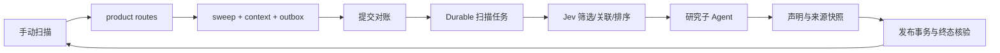

# 从演示到源码：AgentRadar 学习路线

先把项目当作一个可操作的产品，再沿一次扫描追踪数据。无需先学习全部 Durable 内部实现，也不需要购买 API。

## 第一次：跑通一个免费演示

本机已验证 Linux 副本可直接使用，在 PowerShell 输入 `wsl -d Ubuntu` 后执行：

```bash
cd /var/tmp/agentradar-m4-20261027
source ~/.nvm/nvm.sh
nvm use 24
node scripts/learning-demo.mjs
```

打开终端打印的 `http://localhost:端口`。端口动态分配，不固定为 4851；终端保持运行，Ctrl+C 关闭 API 和 Web。脚本每次创建独立 `test-results/learning-demo/session-*`，不加载 `.env`、不读取运行数据库、关闭定时扫描和付费能力。模型与来源均为 fixture，四条研究计划便于观察；不要把画面中的模拟内容说成真实模型结果。

临时副本可能被系统清理。长期使用建议复制到新的 Linux 目录，避免与 Windows 的 node_modules 混用：

```bash
source ~/.nvm/nvm.sh
nvm use 24
learning_root=$(mktemp -d "$HOME/agentradar-learning.XXXXXX")
rsync -a --exclude=.git --exclude=node_modules --exclude=dist --exclude=test-results --exclude=data --exclude=logs --exclude=.env --exclude=dna-network.yaml /mnt/e/agent/Jev/pi-durable-news-agent/ "$learning_root/"
cd "$learning_root"
npm ci
npm run build -w dna-client-browser
node scripts/learning-demo.mjs
```

这个启动入口不需要 just、zsh、Firecrawl 或模型密钥。Node 必须是 Linux Node 24；不要把 Windows Node 路径加入 WSL PATH。`--self-test` 会自动提交一次扫描、核对服务端终态并关闭，适合展示前自检。

打开后按顺序做五件事：

1. 先看来源和四个关注主题。解释“系统为谁筛选什么信息”。
2. 点击“立即扫描”，记录 sweep ID，观察阶段和状态变化。
3. 打开一张卡片和来源证据，找到“声明—引用—快照”的对应关系。区分来源支持与客观事实正确。
4. 展开执行树和判断/费用记录，分清主 Agent、研究子 Agent、Jev 六类判断、工具与服务端校验。
5. 再次扫描并试用收藏、偏好预览和取消。任务太快时不必人为等待取消，改看已有取消/崩溃测试；不要操作正在使用的运行目录。

观察结果应能回答：新闻条目是什么？一次扫描和一次模型调用有什么区别？为什么同一条新闻不能重复发布？为什么失败不能显示成“没有新闻”？

## 第二次：沿一次扫描阅读源码



按以下顺序，每次只追一个实际 ID，不要一开始逐行读全仓：

1. **入口与提交**：`apps/dna-server-api/src/routes/product.ts` → `news/sweep.ts` → `db/repos/submissions.ts` → `news/submissions.ts`。找出 requestId、sweep、context 和 outbox 如何关联。练习解释“业务库已提交，执行库尚未接纳时如何恢复”。
2. **扫描与判断**：`news/sweep-task.ts` → `news/stories.ts` / `news/story-policy.ts` / `news/rank.ts` → `news/operations.ts`。再读 `prompt_engineering/jev/*/command.json` 六类问题。区分 typed 判断、服务端阈值和最终处置，供应商错误不能当成否定答案。
3. **研究与证据**：`agents/tools/research-items.ts` → `research-prompt.ts` → `agents/tools/read-item.ts` → `agents/tools/report-findings.ts` → `news/evidence.ts` / `news/snapshots.ts`。找出研究调用如何绑定最初 sweep/epoch，以及声明如何引用不可变正文。
4. **发布与完成**：`agents/tools/present.ts` → `db/repos/news.ts` → `news/finalization.ts`。解释“为什么模型说完成还不够”，找到唯一发布和缺口检查。
5. **恢复与预算**：`news/lifecycle.ts` / `news/execution.ts` / `db/execution.ts` / `news/budgets.ts` / `news/model-budget.ts`。画出取消时 epoch 变化，理解 unknown attempt 与外部请求可能重复计费。

浏览器部分后读：`apps/dna-client-browser/fe/src/components/ScanPanel.vue`、`InspectionPanel.vue`、`EvidencePanel.vue`。先理解服务端持久记录，再看 UI 如何展示它们。

## 第三次：用测试证明你理解了恢复

在独立 Linux 副本运行：

```bash
node --import tsx --test apps/dna-server-api/tests/submissions.test.ts
node --import tsx --test apps/dna-server-api/tests/lifecycle-recovery.test.ts
node --import tsx --test apps/dna-server-api/tests/evaluation.test.ts
```

先只读一个故障案例：outbox `after_sdk_accept`。预测中断时两个库分别有什么，再执行测试并比较。随后看 `snapshot_committed` 和取消后旧 epoch 拒写。这里的 SIGKILL 由测试在独立子进程注入，不要手动 kill 用户的其他 Node 进程。

演示素材在本机仓库 `test-results/m3-verified/recovery-demo.webm`、`evidence-demo.webm`，现有验收说明在 `docs/m3-verification.md`。展示可以先播放已录制素材，再现场跑一次免费扫描；注明录制的是 fixture，恢复代码和数据库断言是真实执行。

## 第四次：结合这次采集的真实资料

打开 `evaluation/corpora/public-doc-updates-v1/INDEX.md`，先只使用 dev。选一份 AgentScope 的中文工具/权限/研究子 Agent 文档，再找同一组英文原文：核对固定提交、真实更新时间和正文，思考它是实质重复、补证还是不同版本进展。最后看一份 NumPy 变更记录，练习判断它是否符合本产品关注主题。不要把练习答案由模型自动填为 gold。

数据包的 `source-index.jsonl` 保存每条来源路径、提交和日期依据；`snapshots.jsonl` 是真实正文，`annotations.template.jsonl` 是待填表。复制模板中的少量 dev 行，按 `evaluation/rubric.md` 填写身份、时间与标签，使用 `import-annotations` 导入到**新版本**目录。人工复核前不要把模型的评语放到标注者面前。

学习目标是能从一份真实资料讲清“为什么筛选、如何研究、证据在哪里、为什么发布或拒绝”，而不是记住整套提示词。

## 展示时可以准确地怎么说

“AgentRadar 在已有 Pi Durable 与 Jev 上改造了扫描提交 Outbox、重启对账、取消隔离、证据绑定、持久预算和独立评测。这里用免费 fixture 展示工作流与恢复能力；已准备真实公开资料供人工标注，但真实模型质量和成本还没有完成验证。”

保留上游许可与贡献边界。不说跨库 exactly-once、不说绝对不会重复计费、不把 HFS 或来源支持值当成事实真实概率，也不把文档样本包说成已经完成新闻质量验收。
