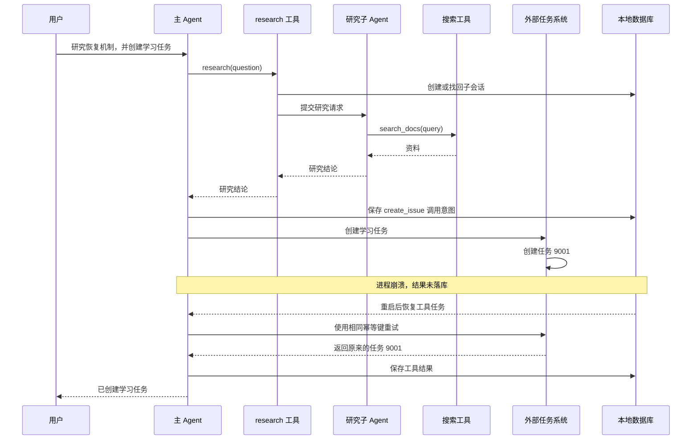
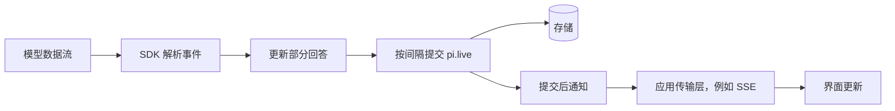
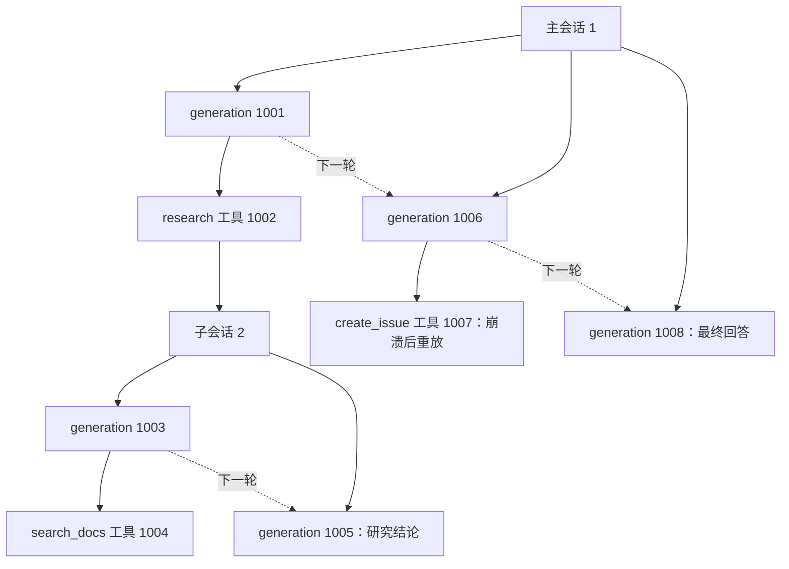

# Pi Durable 完整执行示例：研究、创建任务与崩溃恢复

本文把用户输入、模型请求、工具执行、子 Agent、事务、checkpoint、重放、幂等和流式输出串成一条完整流程。

- 保存日期：2026-11-03。
- 对照版本：本项目安装的 `@earendil-works/pi-durable 1.1.0`。
- 用户目标：研究 Pi Durable 如何恢复任务，然后在外部任务系统创建一条学习任务，把结论写进描述。
- 示例性质：教学推演，不是一次真实运行记录。搜索结果、外部 API、模型名称和编号均为固定示例，没有实际联网创建任务。
- 数据格式：下面是统一后的教学视图，不是原始数据库 schema 或模型供应商协议。展示完整业务内容和理解控制流所需的关联数据；省略时间戳、用量、供应商元数据、系统提示词 Entry、provider session 等非本例主线字段。各步骤列出相关新增或变更，未列出的已有记录保持不变。
- 代码性质：代码块解释机制；省略导入、注册等装配代码，不应视为可直接运行的完整应用。

## 1. 整个故事

两个 Agent：

- 主 Agent：接收要求，委派研究，创建学习任务。
- 研究子 Agent：调用搜索工具，生成研究结论。

三个工具：

- `research`：主 Agent 调用，内部创建或找回研究子会话。
- `search_docs`：研究子 Agent 调用，返回固定资料。
- `create_issue`：主 Agent 调用，在外部系统创建学习任务。

故障注入点：外部任务已创建成功，本地还没保存 memo 和工具结果，进程被杀。



Agent 决定做什么，工具执行操作，Pi Durable 保存并推进执行状态。

## 2. 启动前的定义与初始数据

### 2.1 Agent 提示词

主 Agent：

```text
你是学习助手。
收到研究请求后，先调用 research。
拿到研究结论后，调用 create_issue 创建一条学习任务。
创建成功后，把任务链接告诉用户。
```

研究子 Agent：

```text
你是研究助手。
调用 search_docs 搜索资料。
根据搜索结果，用一句话说明机制，并附上来源链接。
```

### 2.2 工具参数与重放策略

```json
{
  "research": {
    "parameters": {
      "type": "object",
      "properties": {"question": {"type": "string"}},
      "required": ["question"],
      "additionalProperties": false
    },
    "replay": "safe"
  },
  "search_docs": {
    "parameters": {
      "type": "object",
      "properties": {"query": {"type": "string"}},
      "required": ["query"],
      "additionalProperties": false
    },
    "replay": "safe"
  },
  "create_issue": {
    "parameters": {
      "type": "object",
      "properties": {
        "title": {"type": "string"},
        "body": {"type": "string"}
      },
      "required": ["title", "body"],
      "additionalProperties": false
    },
    "replay": "safe"
  }
}
```

`safe` 的前提由实现保证：搜索是读取操作；研究工具复用子会话和提交；创建工具使用外部系统支持的幂等键。声明本身不会让操作自动幂等。

工具、扩展和任务实现安装在当前进程的 Registry 中；重启后仍需注册。数据库不会保存这些 JavaScript 函数的实现代码。

### 2.3 初始状态

本地：

```json
{
  "conversationId": 1,
  "agent": "main",
  "tools": ["research", "create_issue"],
  "entries": [],
  "activeRun": null,
  "inbox": []
}
```

外部任务系统：

```json
{
  "issues": [],
  "idempotencyRecords": {}
}
```

## 3. 用户提交：输入成为持久记录

```ts
const submission = await root.submit(
  {
    type: "input",
    content: "研究 Pi Durable 如何恢复任务，然后创建一条学习任务。",
    requestId: "learn-pi-001",
  },
  ctx,
);
```

完整业务输入：

```json
{
  "conversationId": 1,
  "requestId": "learn-pi-001",
  "type": "input",
  "content": "研究 Pi Durable 如何恢复任务，然后创建一条学习任务。"
}
```

输入被持久接收并开始运行后，相关记录如下：

```json
{
  "submission": {
    "id": 501,
    "conversationId": 1,
    "requestId": "learn-pi-001",
    "status": "pending"
  },
  "entry": {
    "id": 1,
    "conversationId": 1,
    "kind": "pi.user",
    "content": "研究 Pi Durable 如何恢复任务，然后创建一条学习任务。"
  },
  "task": {
    "id": 1001,
    "kind": "pi.generation",
    "conversationId": 1,
    "owner": {"kind": "conversation", "id": 1},
    "status": "pending",
    "checkpoint": {"phase": "prepare", "attempt": 1}
  },
  "activeRun": {
    "conversationId": 1,
    "generationTaskId": 1001,
    "submissionIds": [501]
  }
}
```

各编号有不同含义：会话 `1`、提交 `501`、输入 Entry `1`、生成任务 `1001`。

调用方断线后，向同一会话重试同一 `requestId`，找回原来的 Submission `501`，不会创建第二份用户请求。

## 4. 主 Agent 第一次请求模型

任务 `1001` 从 `prepare` 准备上下文，进入 `request`。教学视图中的 checkpoint：

```json
{
  "phase": "request",
  "attempt": 1,
  "model": "demo-model",
  "contextEntryIds": [1]
}
```

`contextEntryIds` 是教学表示：实际发送给模型的是内容。1.1.0 实现使用请求 cutoff 等信息固定上下文边界，并非存储这个同名字段。

请求的完整业务历史如下；`availableTools` 中的名称引用第 2 节完整工具定义，实际模型请求会包含工具定义：

```json
{
  "system": "你是学习助手。收到研究请求后，先调用 research。拿到研究结论后，调用 create_issue 创建一条学习任务。创建成功后，把任务链接告诉用户。",
  "messages": [
    {
      "role": "user",
      "content": "研究 Pi Durable 如何恢复任务，然后创建一条学习任务。"
    }
  ],
  "availableTools": ["research", "create_issue"]
}
```

模型响应：

```json
{
  "role": "assistant",
  "content": [
    {
      "type": "toolCall",
      "id": "call-research-1",
      "name": "research",
      "arguments": {"question": "Pi Durable 如何恢复任务？"}
    }
  ]
}
```

模型提出调用要求，此时工具还没有执行，子 Agent 也没有启动。

## 5. 原子保存模型决定、工具任务和等待关系

框架在同一个 commit 中保存响应 Entry `2`、创建工具任务 `1002`、让 generation `1001` 等待它：

```json
{
  "entry": {
    "id": 2,
    "conversationId": 1,
    "kind": "pi.assistant",
    "content": [
      {
        "type": "toolCall",
        "id": "call-research-1",
        "name": "research",
        "arguments": {"question": "Pi Durable 如何恢复任务？"}
      }
    ]
  },
  "generationTask": {
    "id": 1001,
    "kind": "pi.generation",
    "status": "waiting",
    "checkpoint": {
      "phase": "tools",
      "assistantEntryId": 2,
      "toolTaskIds": [1002]
    },
    "waitingOn": [1002],
    "policy": "allSettled"
  },
  "toolTask": {
    "id": 1002,
    "kind": "pi.tool",
    "conversationId": 1,
    "owner": {"kind": "task", "id": 1001},
    "input": {"assistantEntryId": 2, "callId": "call-research-1"},
    "status": "pending",
    "checkpoint": {"phase": "call"}
  }
}
```

工具任务能从 Entry `2` 找回名称和参数，不依赖先前模型请求函数中的局部变量。

原子性保证这组持久修改全部生效或全部不生效，不留下“模型决定保存了，工具任务却没创建”的半成品。如果存储已提交、进程却未收到确认就崩溃，恢复时需要查询已有记录；不能仅凭调用方没收到成功就断定没有提交。

## 6. 研究工具记录意图，创建子会话

工具任务 `1002` 解析工具、校验参数，通过钩子检查后，先保存意图，再调用实现：

```json
{
  "taskId": 1002,
  "status": "running",
  "checkpoint": {
    "phase": "execute",
    "arguments": {"question": "Pi Durable 如何恢复任务？"},
    "replay": "safe"
  }
}
```

本例使用项目已有的 `onceInCommit()` 辅助函数创建子会话：

```ts
const childId = await onceInCommit(api, ctx, async (tx) => {
  const child = await tx.createConversation({
    ownership: { kind: "task", taskId: api.taskId },
  });
  await configure(tx, child.id, researcherAgent);
  return child.id;
});

const child = await api.conversation(childId, ctx);
const submission = await child.submit(
  {
    type: "input",
    content: args.question,
    requestId: `research:${api.taskId}`,
  },
  ctx,
);
const result = await submission.wait(ctx);
```

其中 `researcherAgent` 表示第 2 节的子 Agent 配置。项目的 `spawnSubagents()` 采用按 owner task 查找已有孩子的方式；本例用 `onceInCommit()` 展示同一类复用保证，不声称这是其原样实现。

创建子会话和保存执行凭据在同一事务内：

```json
{
  "childConversation": {
    "id": 2,
    "agent": "researcher",
    "tools": ["search_docs"],
    "owner": {"kind": "task", "id": 1002},
    "entries": []
  },
  "taskReceipt": {
    "scope": "task",
    "taskId": 1002,
    "value": 2
  }
}
```

凭据的含义是“工具任务 1002 创建子会话的结果为 2”。重放时读到凭据，直接返回 `2`，不再创建另一个会话。

`onceInCommit()` 的核心实现：

```ts
return api.commit(async (tx) => {
  const receipt = await tx.doc(TaskReceipt, api.taskId);
  if (receipt.value !== null) return receipt.value;
  const value = await fn(tx);
  receipt.value = value;
  return value;
}, ctx);
```

这只保证同一存储事务中的修改。若 `fn` 调用外部邮件 API，数据库事务不能撤销已经发出的邮件。

## 7. 向子会话提交研究请求

父工具提交：

```json
{
  "conversationId": 2,
  "requestId": "research:1002",
  "type": "input",
  "content": "Pi Durable 如何恢复任务？"
}
```

新增数据：

```json
{
  "submission": {
    "id": 502,
    "conversationId": 2,
    "requestId": "research:1002",
    "status": "pending"
  },
  "entry": {
    "id": 3,
    "conversationId": 2,
    "kind": "pi.user",
    "content": "Pi Durable 如何恢复任务？"
  },
  "generationTask": {
    "id": 1003,
    "kind": "pi.generation",
    "conversationId": 2,
    "owner": {"kind": "conversation", "id": 2},
    "status": "pending",
    "checkpoint": {"phase": "prepare", "attempt": 1}
  }
}
```

父工具执行 `await submission.wait(ctx)`，等待期间子 Agent 可以运行。

JavaScript 的 `await` 不等于任务记录自动变成持久的 `waiting`。父工具任务可以仍是 `running`，其重启恢复依赖安全重放和稳定标识：

```text
读凭据 → 子会话仍是 2
用 requestId = research:1002 再次 submit
框架找回 Submission 502
502 未完成 → 继续等；502 已完成 → 读取原答案
```

找到相同子会话，只找到了同一个研究员；相同 requestId 才找到了交给他的同一份工作。

## 8. 子 Agent 第一次模型请求与搜索执行

模型请求：

```json
{
  "system": "你是研究助手。调用 search_docs 搜索资料。根据搜索结果，用一句话说明机制，并附上来源链接。",
  "messages": [
    {"role": "user", "content": "Pi Durable 如何恢复任务？"}
  ],
  "availableTools": ["search_docs"]
}
```

模型响应：

```json
{
  "role": "assistant",
  "content": [
    {
      "type": "toolCall",
      "id": "call-search-1",
      "name": "search_docs",
      "arguments": {"query": "Pi Durable checkpoint resume"}
    }
  ]
}
```

原子提交：

```json
{
  "entry": {
    "id": 4,
    "conversationId": 2,
    "kind": "pi.assistant",
    "content": [
      {
        "type": "toolCall",
        "id": "call-search-1",
        "name": "search_docs",
        "arguments": {"query": "Pi Durable checkpoint resume"}
      }
    ]
  },
  "generationTask": {
    "id": 1003,
    "status": "waiting",
    "checkpoint": {
      "phase": "tools",
      "assistantEntryId": 4,
      "toolTaskIds": [1004]
    },
    "waitingOn": [1004],
    "policy": "allSettled"
  },
  "toolTask": {
    "id": 1004,
    "kind": "pi.tool",
    "conversationId": 2,
    "owner": {"kind": "task", "id": 1003},
    "input": {"assistantEntryId": 4, "callId": "call-search-1"},
    "status": "pending",
    "checkpoint": {"phase": "call"}
  }
}
```

搜索工具执行前保存意图：

```json
{
  "taskId": 1004,
  "status": "running",
  "checkpoint": {
    "phase": "execute",
    "arguments": {"query": "Pi Durable checkpoint resume"},
    "replay": "safe"
  }
}
```

固定搜索输出：

```json
{
  "title": "Pi Durable 恢复机制",
  "url": "https://docs.example.test/pi-durable",
  "excerpt": "任务阶段和必要数据通过 checkpoint 保存；重启后调度器从保存的阶段继续，未完成阶段可能重新执行。"
}
```

工具把输出格式化为文本，保存 Entry `5`，并结束任务 `1004`：

```json
{
  "entry": {
    "id": 5,
    "conversationId": 2,
    "kind": "pi.tool-result",
    "toolCallId": "call-search-1",
    "toolName": "search_docs",
    "isError": false,
    "text": "标题：Pi Durable 恢复机制\n来源：https://docs.example.test/pi-durable\n内容：任务阶段和必要数据通过 checkpoint 保存；重启后调度器从保存的阶段继续，未完成阶段可能重新执行。"
  },
  "task": {
    "id": 1004,
    "status": "terminal",
    "outcome": {"status": "completed"}
  }
}
```

`1003` 的等待条件满足，完成这一轮工具处理，并安排新的 generation `1005`。`allSettled` 表示等待全部指定任务结束，成功或失败都算结束，不要求它们全部成功。

## 9. 子 Agent 第二次模型请求与研究结果

完整业务历史：

```json
{
  "system": "你是研究助手。调用 search_docs 搜索资料。根据搜索结果，用一句话说明机制，并附上来源链接。",
  "messages": [
    {"role": "user", "content": "Pi Durable 如何恢复任务？"},
    {
      "role": "assistant",
      "toolCall": {
        "id": "call-search-1",
        "name": "search_docs",
        "arguments": {"query": "Pi Durable checkpoint resume"}
      }
    },
    {
      "role": "tool",
      "toolCallId": "call-search-1",
      "name": "search_docs",
      "content": "标题：Pi Durable 恢复机制\n来源：https://docs.example.test/pi-durable\n内容：任务阶段和必要数据通过 checkpoint 保存；重启后调度器从保存的阶段继续，未完成阶段可能重新执行。"
    }
  ],
  "availableTools": ["search_docs"]
}
```

模型响应：

```json
{
  "role": "assistant",
  "text": "Pi Durable 保存任务阶段和必要数据，重启后从 checkpoint 继续；未完成阶段可能重跑，因此外部副作用需要幂等。来源：https://docs.example.test/pi-durable"
}
```

保存结果、结束子 Run：

```json
{
  "entry": {
    "id": 6,
    "conversationId": 2,
    "kind": "pi.assistant",
    "text": "Pi Durable 保存任务阶段和必要数据，重启后从 checkpoint 继续；未完成阶段可能重跑，因此外部副作用需要幂等。来源：https://docs.example.test/pi-durable"
  },
  "generationTask": {
    "id": 1005,
    "status": "terminal",
    "outcome": {"status": "completed"}
  },
  "submission": {"id": 502, "status": "done", "answerEntryId": 6},
  "childActiveRun": null
}
```

父工具的等待返回，读取 Entry `6`，把它作为研究工具结果保存到父会话：

```json
{
  "entry": {
    "id": 7,
    "conversationId": 1,
    "kind": "pi.tool-result",
    "toolCallId": "call-research-1",
    "toolName": "research",
    "isError": false,
    "text": "Pi Durable 保存任务阶段和必要数据，重启后从 checkpoint 继续；未完成阶段可能重跑，因此外部副作用需要幂等。来源：https://docs.example.test/pi-durable"
  },
  "researchToolTask": {
    "id": 1002,
    "status": "terminal",
    "outcome": {"status": "completed"}
  }
}
```

父会话收到研究结论，不自动包含子会话全部搜索历史。generation `1001` 完成本轮后，安排下一轮 `1006`。

## 10. 主 Agent 第二次模型请求：决定创建任务

```json
{
  "system": "你是学习助手。收到研究请求后，先调用 research。拿到研究结论后，调用 create_issue 创建一条学习任务。创建成功后，把任务链接告诉用户。",
  "messages": [
    {
      "role": "user",
      "content": "研究 Pi Durable 如何恢复任务，然后创建一条学习任务。"
    },
    {
      "role": "assistant",
      "toolCall": {
        "id": "call-research-1",
        "name": "research",
        "arguments": {"question": "Pi Durable 如何恢复任务？"}
      }
    },
    {
      "role": "tool",
      "toolCallId": "call-research-1",
      "name": "research",
      "content": "Pi Durable 保存任务阶段和必要数据，重启后从 checkpoint 继续；未完成阶段可能重跑，因此外部副作用需要幂等。来源：https://docs.example.test/pi-durable"
    }
  ],
  "availableTools": ["research", "create_issue"]
}
```

模型响应：

```json
{
  "role": "assistant",
  "toolCall": {
    "id": "call-create-1",
    "name": "create_issue",
    "arguments": {
      "title": "学习 Pi Durable 恢复机制",
      "body": "Pi Durable 保存任务阶段和必要数据，重启后从 checkpoint 继续；未完成阶段可能重跑，因此外部副作用需要幂等。来源：https://docs.example.test/pi-durable"
    }
  }
}
```

原子保存响应、工具任务、等待关系：

```json
{
  "entry": {
    "id": 8,
    "conversationId": 1,
    "kind": "pi.assistant",
    "toolCall": {
      "id": "call-create-1",
      "name": "create_issue",
      "arguments": {
        "title": "学习 Pi Durable 恢复机制",
        "body": "Pi Durable 保存任务阶段和必要数据，重启后从 checkpoint 继续；未完成阶段可能重跑，因此外部副作用需要幂等。来源：https://docs.example.test/pi-durable"
      }
    }
  },
  "generationTask": {
    "id": 1006,
    "status": "waiting",
    "checkpoint": {
      "phase": "tools",
      "assistantEntryId": 8,
      "toolTaskIds": [1007]
    },
    "waitingOn": [1007],
    "policy": "allSettled"
  },
  "toolTask": {
    "id": 1007,
    "kind": "pi.tool",
    "conversationId": 1,
    "owner": {"kind": "task", "id": 1006},
    "input": {"assistantEntryId": 8, "callId": "call-create-1"},
    "status": "pending",
    "checkpoint": {"phase": "call"}
  }
}
```

## 11. 创建工具：memo 与外部幂等键

工具实现的核心业务：

```ts
const result = await once(api, "issue-result", ctx, async () => {
  return issueClient.create({
    idempotencyKey: `create-issue:${api.taskId}`,
    title: args.title,
    body: args.body,
  });
});
return toolText(JSON.stringify(result));
```

本地 memo 键是 `issue-result`，作用域是工具任务 `1007`；外部幂等键是 `create-issue:1007`。

`once()` 的行为是：有 memo 就返回；没有就执行操作，然后保存结果。操作和 memo 之间仍有崩溃窗口，因此需要外部幂等。

框架先保存意图：

```json
{
  "taskId": 1007,
  "status": "running",
  "checkpoint": {
    "phase": "execute",
    "arguments": {
      "title": "学习 Pi Durable 恢复机制",
      "body": "Pi Durable 保存任务阶段和必要数据，重启后从 checkpoint 继续；未完成阶段可能重跑，因此外部副作用需要幂等。来源：https://docs.example.test/pi-durable"
    },
    "replay": "safe"
  },
  "memos": {}
}
```

没有查到 memo，发起请求：

```http
POST /issues HTTP/1.1
Host: tasks.example.test
Content-Type: application/json
Idempotency-Key: create-issue:1007

{
  "title": "学习 Pi Durable 恢复机制",
  "body": "Pi Durable 保存任务阶段和必要数据，重启后从 checkpoint 继续；未完成阶段可能重跑，因此外部副作用需要幂等。来源：https://docs.example.test/pi-durable"
}
```

本例外部 API 的契约：同一个幂等键和相同请求体，在本次重试期间始终返回同一创建结果。服务端必须实现这份契约，客户端只传一个键并不足够。该示例服务把创建记录和幂等映射原子保存。

外部保存：

```json
{
  "issues": [
    {
      "id": 9001,
      "title": "学习 Pi Durable 恢复机制",
      "body": "Pi Durable 保存任务阶段和必要数据，重启后从 checkpoint 继续；未完成阶段可能重跑，因此外部副作用需要幂等。来源：https://docs.example.test/pi-durable",
      "url": "https://tasks.example.test/issues/9001"
    }
  ],
  "idempotencyRecords": {
    "create-issue:1007": {
      "issueId": 9001,
      "response": {
        "id": 9001,
        "url": "https://tasks.example.test/issues/9001"
      }
    }
  }
}
```

外部响应：

```json
{
  "id": 9001,
  "url": "https://tasks.example.test/issues/9001"
}
```

现在杀死进程：外部已经成功，本地 `once()` 尚未保存 memo，工具也尚未完成落库。

## 12. 崩溃瞬间的完整关键状态

本地：

```json
{
  "userSubmission": {"id": 501, "status": "pending"},
  "generationTask": {
    "id": 1006,
    "status": "waiting",
    "waitingOn": [1007],
    "checkpoint": {
      "phase": "tools",
      "assistantEntryId": 8,
      "toolTaskIds": [1007]
    }
  },
  "createIssueTask": {
    "id": 1007,
    "status": "running",
    "checkpoint": {
      "phase": "execute",
      "arguments": {
        "title": "学习 Pi Durable 恢复机制",
        "body": "Pi Durable 保存任务阶段和必要数据，重启后从 checkpoint 继续；未完成阶段可能重跑，因此外部副作用需要幂等。来源：https://docs.example.test/pi-durable"
      },
      "replay": "safe"
    },
    "memos": {}
  },
  "createIssueResultEntry": null
}
```

外部：

```json
{
  "createdIssueIds": [9001],
  "idempotencyRecords": {
    "create-issue:1007": {
      "issueId": 9001,
      "response": {
        "id": 9001,
        "url": "https://tasks.example.test/issues/9001"
      }
    }
  }
}
```

本地知道调用进入过执行阶段，但不知道外部是否成功；外部已经创建了记录。本地事务不能自动跨系统证明外部结果。

## 13. 重启恢复：checkpoint 找阶段，幂等键找结果

```ts
const harness = await Harness.open(storage, { models, registry }, ctx);
harness.resume();
```

打开存储时加载未完成任务，把 `running` 的工具 `1007` 改回 `pending`，保留 checkpoint。启动调度后重新执行该阶段：

```json
{
  "taskId": 1007,
  "status": "pending",
  "checkpoint": {
    "phase": "execute",
    "arguments": {
      "title": "学习 Pi Durable 恢复机制",
      "body": "Pi Durable 保存任务阶段和必要数据，重启后从 checkpoint 继续；未完成阶段可能重跑，因此外部副作用需要幂等。来源：https://docs.example.test/pi-durable"
    },
    "replay": "safe"
  },
  "memos": {}
}
```

保存的策略和当前工具定义都声明 `safe`，允许重跑。默认 unsafe 工具则会产生 `interrupted` 错误，不自动重跑。

```text
重新进入 execute
  → once() 查询 issue-result
  → memo 不存在
  → 再次发送与第 11 节相同的 HTTP 请求
  → 幂等键仍为 create-issue:1007
  → 外部系统返回原来的 9001，没有创建 9002
```

返回内容：

```json
{
  "id": 9001,
  "url": "https://tasks.example.test/issues/9001"
}
```

这次本地成功保存 memo：

```json
{
  "taskId": 1007,
  "memos": {
    "issue-result": {
      "id": 9001,
      "url": "https://tasks.example.test/issues/9001"
    }
  }
}
```

如果现在再次崩溃，工具恢复后可以直接读 memo，不必请求外部 API。

随后正式保存工具结果并结束工具任务：

```json
{
  "entry": {
    "id": 9,
    "conversationId": 1,
    "kind": "pi.tool-result",
    "toolCallId": "call-create-1",
    "toolName": "create_issue",
    "isError": false,
    "text": "{\"id\":9001,\"url\":\"https://tasks.example.test/issues/9001\"}"
  },
  "toolTask": {
    "id": 1007,
    "status": "terminal",
    "outcome": {"status": "completed"}
  }
}
```

memo 是活跃任务期间的恢复辅助数据，不能当永久业务账本。任务决定 outcome 后，正式工具结果 Entry 承担历史记录作用。

三种机制各司其职：

- checkpoint：找回执行阶段和参数。
- memo：复用已经记下来的步骤结果。
- 外部幂等：填补外部成功、本地未记账的窗口。

恢复的是状态机阶段，不是 JavaScript 调用栈、局部变量或旧网络连接。未持久保存的阶段内工作可能重跑。

## 14. 主 Agent 第三次模型请求与流式最终回答

工具 `1007` 完成后，generation `1006` 完成本轮并安排下一轮 `1008`。

完整业务请求：

```json
{
  "system": "你是学习助手。收到研究请求后，先调用 research。拿到研究结论后，调用 create_issue 创建一条学习任务。创建成功后，把任务链接告诉用户。",
  "messages": [
    {
      "role": "user",
      "content": "研究 Pi Durable 如何恢复任务，然后创建一条学习任务。"
    },
    {
      "role": "assistant",
      "toolCall": {
        "id": "call-research-1",
        "name": "research",
        "arguments": {"question": "Pi Durable 如何恢复任务？"}
      }
    },
    {
      "role": "tool",
      "toolCallId": "call-research-1",
      "name": "research",
      "content": "Pi Durable 保存任务阶段和必要数据，重启后从 checkpoint 继续；未完成阶段可能重跑，因此外部副作用需要幂等。来源：https://docs.example.test/pi-durable"
    },
    {
      "role": "assistant",
      "toolCall": {
        "id": "call-create-1",
        "name": "create_issue",
        "arguments": {
          "title": "学习 Pi Durable 恢复机制",
          "body": "Pi Durable 保存任务阶段和必要数据，重启后从 checkpoint 继续；未完成阶段可能重跑，因此外部副作用需要幂等。来源：https://docs.example.test/pi-durable"
        }
      }
    },
    {
      "role": "tool",
      "toolCallId": "call-create-1",
      "name": "create_issue",
      "content": "{\"id\":9001,\"url\":\"https://tasks.example.test/issues/9001\"}"
    }
  ],
  "availableTools": ["research", "create_issue"]
}
```

假设供应商返回三个数据块：

```json
[
  "已创建学习任务。",
  "Pi Durable 通过 checkpoint 恢复执行，外部操作需要幂等。",
  "任务链接：https://tasks.example.test/issues/9001"
]
```

部分回答依次成为：

```json
[
  {
    "conversationId": 1,
    "generationTaskId": 1008,
    "partialText": "已创建学习任务。"
  },
  {
    "conversationId": 1,
    "generationTaskId": 1008,
    "partialText": "已创建学习任务。Pi Durable 通过 checkpoint 恢复执行，外部操作需要幂等。"
  },
  {
    "conversationId": 1,
    "generationTaskId": 1008,
    "partialText": "已创建学习任务。Pi Durable 通过 checkpoint 恢复执行，外部操作需要幂等。任务链接：https://tasks.example.test/issues/9001"
  }
]
```

这是教学展示。实际框架按间隔合并提交部分回答到 `pi.live`，不保证每个网络块单独写库。本项目配置的 `partialIntervalMs` 和 `outputIntervalMs` 都为 100 毫秒；实际延迟还受调度、存储等影响。



网络块不一定等于 token。保存了部分回答，也不等于重启后能从原连接的下一个 token 继续。

生成结束后保存最终 Entry，并结束用户提交：

```json
{
  "entry": {
    "id": 10,
    "conversationId": 1,
    "kind": "pi.assistant",
    "text": "已创建学习任务。Pi Durable 通过 checkpoint 恢复执行，外部操作需要幂等。任务链接：https://tasks.example.test/issues/9001"
  },
  "generationTask": {
    "id": 1008,
    "status": "terminal",
    "outcome": {"status": "completed"}
  },
  "submission": {"id": 501, "status": "done", "answerEntryId": 10},
  "activeRun": null,
  "inbox": []
}
```

调用方的 `await submission.wait(ctx)` 完成。若调用方也重启了，可以按 Submission ID 找回，或向同一会话用原 requestId 重试以取得原提交。

## 15. 最终历史、任务关系与计数

主会话 `1`：

```text
Entry 1：用户要求研究并创建任务
Entry 2：模型调用 research
Entry 7：research 返回研究结论
Entry 8：模型调用 create_issue
Entry 9：create_issue 返回任务 9001
Entry 10：模型给出最终回答
```

子会话 `2`：

```text
Entry 3：父工具交来的研究问题
Entry 4：模型调用 search_docs
Entry 5：search_docs 返回资料
Entry 6：模型给出研究结论
```

编号交错来自同一套示例编号，不代表父会话能自动看到子会话全部内容。

实线表示所属关系，虚线表示下一轮控制交接：



这是历史关系示意。框架的 live task graph 只展示仍存活的任务，任务终结后不会一直保留在 live graph 中。

最终结果：

```json
{
  "parentSubmission": {
    "id": 501,
    "requestId": "learn-pi-001",
    "status": "done",
    "answerEntryId": 10
  },
  "childSubmission": {
    "id": 502,
    "requestId": "research:1002",
    "status": "done",
    "answerEntryId": 6
  },
  "conversationIds": [1, 2],
  "entryIds": [1, 2, 3, 4, 5, 6, 7, 8, 9, 10],
  "taskIds": [1001, 1002, 1003, 1004, 1005, 1006, 1007, 1008],
  "allTasksTerminal": true,
  "externalIssueIds": [9001],
  "externalCreateRequests": 2,
  "externalIssuesCreated": 1
}
```

一共五次模型生成：主 Agent 三次，子 Agent 两次；三个工具任务；两个会话；两个 Submission；十条业务 Entry。外部创建请求发了两次，但只创建一条记录。

## 16. 用这个例子复习各机制

- `await`：在当前进程中等待结果，允许事件循环处理其他已安排的异步工作。它本身不提供跨进程持久性，也不会自动让顺序调用并发。
- `pi.generation`：管理一轮模型请求及其工具轮，结束后可以把控制交给新的 generation。
- `pi.tool`：把一次工具调用变成持久工作，保存意图和结果，明确重放规则。
- commit：把同一存储内的响应、任务创建和等待关系一起保存；先提交，再发布给观察者。
- checkpoint：标记恢复时进入哪个阶段，带上所需数据；不是原程序调用栈的快照。
- `requestId`：找回同一会话里的同一次输入提交；同一请求的重试用同一 ID，新请求用新 ID。
- `onceInCommit()`：本项目辅助函数，把事务内操作与执行凭据一起保存，适合创建子会话或任务。
- memo：复用活跃任务里已保存的步骤结果；结果尚未写入前的副作用窗口仍需处理。
- 外部幂等键：外部已经成功、本地还没记账时，重复请求仍得到同一业务结果。
- 所有权：明确父工具和子会话的生命周期关系，支持取消传播；后台任务可建立独立取消边界。取消不会自动撤销外部已产生的效果。
- 流式提交：把部分输出按间隔提交为可观察状态，最终再保存正式回答。

本例未触发上下文压缩、忙时输入排队和取消分支，也没有并发调用多个独立工具。它们建立在相同的会话、任务和提交机制之上。存储选用持久后端才有跨重启恢复；`MemoryStorage` 不具备这种保证。

## 17. 对照源码

以下相对链接以本文件所在 `docs` 为起点：

- [Pi Durable 本地说明](../node_modules/@earendil-works/pi-durable/README.md)：核心概念、存储与恢复语义。
- [项目 Harness 封装](../apps/shared/packages/durable-agent/src/harness.ts)：SQLite、重试、并行工具与进度配置。
- [generation 实现](../node_modules/@earendil-works/pi-durable/dist/harness/generation.js)：prepare、request、tools，以及生成轮交接。
- [tool 实现](../node_modules/@earendil-works/pi-durable/dist/harness/tool.js)：意图保存、safe 检查与工具结果提交。
- [scheduler 实现](../node_modules/@earendil-works/pi-durable/dist/harness/scheduler.js)：打开时恢复任务状态及阶段调度。
- [Session 实现](../node_modules/@earendil-works/pi-durable/dist/session/session.js)：存储提交、采用状态、发布通知的顺序。
- [项目工具辅助函数](../apps/shared/packages/durable-agent/src/tools.ts)：`once()`、`TaskReceipt`、`onceInCommit()`。
- [项目子 Agent 封装](../apps/shared/packages/durable-agent/src/subagents.ts)：按 owner task 找孩子，固定 requestId 复用提交。
- [项目恢复测试](../apps/shared/packages/durable-agent/tests/recovery.test.ts)：安全工具重放、不安全工具中断和子 Agent 恢复。

`node_modules` 链接需安装本项目依赖后才能访问；本文件的教学数据不是这些源码的原始 dump。
