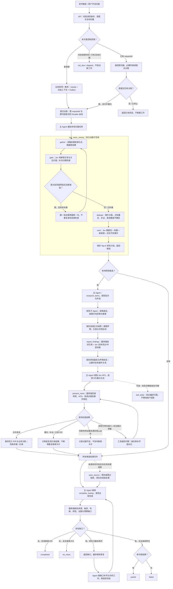
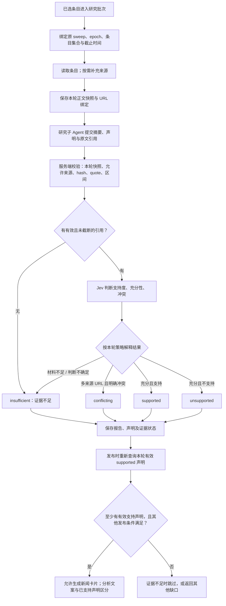
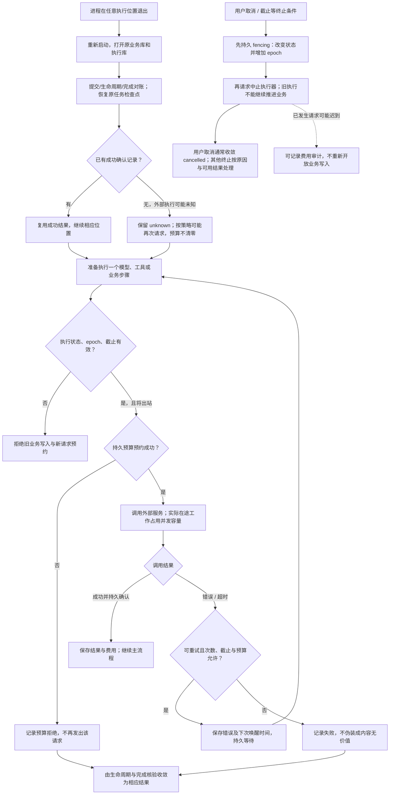

# AgentRadar：一轮扫描的含义与完整流程

核对日期：2026-10-28。图示依据当前扫描受理、持久任务、研究工具、发布和最终核验实现整理。它描述业务主线及主要分支，不表示模型总会按提示一次性正确调用所有工具；实际执行受工具与服务端检查约束。

## 一、一轮扫描是什么意思？

**一轮扫描，英文 sweep，是系统围绕本轮关注主题、来源和预算执行一次技术情报发现、研究与交付的业务任务。**

受理后有独立的 sweep ID，保存本轮配置、进度、条目处置、研究与发布结果，最后收敛到明确状态。定时或手动发起的新扫描可能成为下一轮；同一请求重试或原任务重启恢复，应继续关联原扫描，不能把它当成新一轮。

例如：上午启动 sweep=42，采集若干更新，筛选、关联并研究部分内容，最终发布卡片或记录无新闻、部分完成等状态；下午再次新建扫描则可能是 sweep=43。数字仅为示例，卡片与条目数量不作固定保证。

**它是项目核心业务主流程的一次运行。** 项目还包含偏好设置、收藏、反馈、聊天与运行观测等功能，这些不都属于本轮扫描内部。

如果已理解箭头顺序，但仍不清楚每一步拿到什么数据、调用谁、保存什么，请继续阅读 [跟着一条技术更新学懂 AgentRadar](single-news-walkthrough.md)。该文件用一条虚构新闻逐步走完主线，再加入失败、重试、恢复和取消，并标明第一天必学范围。

特别区分两个范围：

- **业务上的一轮扫描：**受理→执行→研究→发布→最终核验。
- **`run_news_sweep` 工具及其持久子任务：**主要完成 gather→gate→dedupe→rank，再把候选返回主 Agent。工具返回不等于整轮业务已经完成。

“扫描”也不是只抓一个网页，更不是一次模型请求；一轮可以包含多个来源、多个条目、多个判断操作与研究请求。

## 二、完整业务主流程

实线表示主流程与分支，虚线表示可选辅助行为。预算、执行版本和状态检查贯穿工具执行，恢复与取消见后面两张图。

### 主图怎样读

1. **受理层：**API 决定是否新建业务扫描；前置配置校验不通过的请求会被拒绝，图中省略常规鉴权/参数错误。`not_due` 是调度未到期；`skipped` 是因已有活动任务等原因未启动新工作，不是一次执行失败。
2. **提交层：**Outbox 保存提交意图，对账负责送入执行会话。SDK 与业务库之间存在确认窗口，所以不能只画一根“API 直接启动成功”的箭头。
3. **扫描子任务：**框内四阶段通过检查点推进。无新内容时可换一组主题补搜一次；不代表无限搜索，也不保证最终一定有候选。
4. **研究层：**主 Agent 通过工具调度研究子 Agent。正文读取、引用校验和 claim-support 判断发生在研究与报告提交过程中；HFS 不是证据检查的替代品，研究过程中也可能按需调用判断工具。
5. **发布层：**逐条处理有多个结果，研究不一定产生新卡片。事件补证、重复内容和证据不足都可能不发卡。
6. **完成层：**`complete_sweep` 是申请检查，服务端决定终态。无卡片不自动等于 no_news，有卡片也不自动等于 completed。

图中从“工具问题”回到发布表示逻辑上的纠正循环，实际可能先回到读取、研究或分类工具；图中从“所有候选处理完毕”到完成表示计划主线，可选来源线索一旦存在也必须处理，不是任意忽略。

## 三、研究与证据子流程

这张图展开主图中从研究子 Agent 到报告保存的部分，帮助区分确定性检查和模型判断。

这里的 supported 表示当前材料对声明的支持判断，不能直接当作客观事实已被证明。不同 URL 也不必然是独立来源。

## 四、贯穿流程的失败、恢复与取消

正常流程图中的每个外部请求和受保护的业务动作，还受以下机制约束。图中“恢复位置”依实际记录而定，并非统一回到 gather。

补充说明：

- 没有出站的本地步骤不需要为“外部请求”预约预算，图中预约分支只描述出站步骤。
- 进程重启要有实际服务恢复与原存储，不能把机器关机理解为系统仍在计算。
- 供应商已完成但本地未确认的窗口可能重复请求、重复计费，不能承诺全链路 exactly-once。
- 最终核验不能无限修复；已终止或预算耗尽的工作不能通过修复绕过约束。
- 接纳前的 skipped/not_due 与接纳后执行的 completed/no_news/partial/failed/cancelled 属于不同阶段的结果。

## 五、贯穿主流程的三个保存对象

**扫描上下文：**本轮采用哪些主题、来源、模型、提示、策略、预算与参考时间，恢复时继续使用原上下文。

**执行与业务状态：**任务检查点、提交意图、判断 operation/attempt、条目处置与终态缺口，回答“做到哪里、为什么等待或失败”。

**研究与产物：**正文快照、声明、引用、报告和卡片，回答“读到了什么、结论依据是什么、最后交付了什么”。

它们协作，才构成可恢复、可追溯的一轮扫描；只保存聊天文本不足以替代这些状态。

## 六、面试时怎样回答

> 一轮扫描是项目核心业务主流程的一次运行，对应独立 sweep ID。它从手动或定时触发开始，受理后保存上下文和提交意图，通过 Durable 主会话调用持久扫描任务，完成采集、筛选、事件关联与排序。随后主 Agent 调度研究子 Agent，读取来源、提交声明并完成证据和 HFS 检查。服务端满足发布条件后生成卡片，最后检查整轮缺口并计算完成、无新闻、部分完成或失败等状态。扫描子任务返回候选只是中间结果，不是整轮结束。

## 七、实现核对入口

- [扫描受理](../apps/dna-server-api/src/news/sweep.ts)
- [提交对账](../apps/dna-server-api/src/news/submissions.ts)
- [run_news_sweep 工具](../apps/dna-server-api/src/agents/tools/run-news-sweep.ts)
- [四阶段持久任务](../apps/dna-server-api/src/news/sweep-task.ts)
- [研究调度](../apps/dna-server-api/src/agents/tools/research-items.ts)
- [研究报告与声明校验](../apps/dna-server-api/src/agents/tools/report-findings.ts)
- [卡片发布](../apps/dna-server-api/src/agents/tools/present.ts)
- [非阻塞偏好提问](../apps/dna-server-api/src/agents/tools/ask-taste.ts)
- [完成请求](../apps/dna-server-api/src/agents/tools/complete-sweep.ts)
- [服务端最终核验](../apps/dna-server-api/src/news/finalization.ts)
- [取消与生命周期](../apps/dna-server-api/src/news/lifecycle.ts)

提示词中可能保留旧批次数或旧流程表述；当前研究容量与发布要求以工具参数、业务检查和实际实现为准。例如，研究工具当前最多两个批次，扫描内发布需要研究与有效证据，不能依据“剩余候选直接凭原文发布”的旧提示跳过检查。
