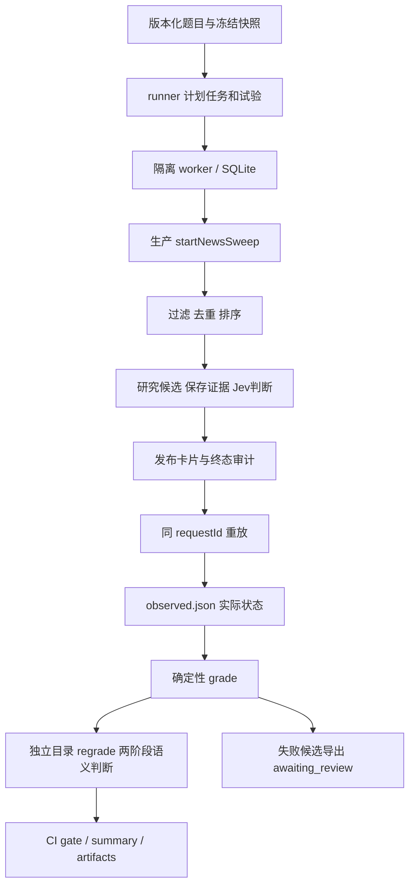

# AgentRadar 自动评测体系：实现复盘与总览

版本日期：2026-11-17。首轮实现基准：`23e8af9`；后续修复和最新实测统一见 [剩余四项的实施与操作](COMPLETION-RUNBOOK.md)，当前评测实现已推进至 `43a5bb3`。本节保留早期实验，不能将历史失败当成最新运行状态。

本文从“把六个取证任务接到可执行评测入口”开始，覆盖数据、真实工作流、评分器、校准、复评、策略实验、失败回流、CI 与每日调度。依据为当前源码、保存的实验报告、会话中的实际运行记录和官方外部资料。无法取得的历史日志不补造。

阅读顺序：

1. 本文：理解系统为什么这样构建，以及实际验证到了哪里。
2. [从零复刻手册](REPRODUCE.md)：从新电脑到本地评测、GitHub 自动运行。
3. [行业对照、升级路线与通用方法论](METHODOLOGY.md)：将实现经验迁移到其他 Agent。

## 1. 当前系统究竟是什么

这是一个面向新闻/技术情报 Agent 的、基于冻结证据的可重复开发评测系统。它通过真实生产扫描入口运行 Agent，检查真实落库结果，组合确定性评分和模型语义评审，并在 GitHub 上提供免费回归与定时真实模型调用。

它不只是给最终答案打分：还检查任务终态、实际研究、证据引用、请求预算和重复提交副作用。后续已实现失败合并复评、脱敏、模型辅助审核、不可变版本入库、可执行回归和效果追踪；真实生产反馈带来的业务改善仍需实际使用数据验证。

必须区分三个“真实”：

- 真实来源：语料含真实公开文档的历史快照。
- 真实模型：`--backend live` 调用 DeepSeek 和 OpenRouter/Jev。
- 真实互联网环境：当前主评测未覆盖。`workflow.mjs` 即使 live 也使用冻结来源、关闭实时搜索/自动发现，避免网页变化干扰比较。

所以本项目证明的是“模型面对固定证据时能否正确执行”，不是“今天全网搜索新闻有多好”。

## 2. 首轮构建时的历史验收记录

当前状态以 [实施与验证记录](COMPLETION-RUNBOOK.md) 为准。以下记录说明首轮失败如何被发现和归因，保留它们用于审计，不作为最新验收结论。

- 本地七题真实模型回归 `pilot-suite-k2-1794839214`，同模型复评 7/7，通过；六题 completed、每题一张卡，空题 no_news、零卡，审计无缺项。
- K=2 是上限。该轮只有 pilot-02 研究两项，其他非空题各一项，不能声称七题都测试了双候选。
- 工作流报告/估算费用合计 0.051773496 美元，不含另行执行的语义复评费用，不是完整账单。
- 确定性评分校准 48/48；旧语义集 36/36、新等价/混淆集 6/6。它们来自模型辅助标签、已暴露开发集，不是独立准确率估计。
- 首轮本地离线测试 31/31。首次 [GitHub 免费 CI](https://github.com/Hongjian01/pi-durable-news-agent/actions/runs/43904948143) 已成功，包含安装依赖、类型检查、离线测试、评分校准、fixture 及 artifact。
- 每日 09:17 北京时间调度已发布，环境已存在。第一次手动运行因未勾付费确认而 skipped。
- **首轮云端真实运行 [43907971612](https://github.com/Hongjian01/pi-durable-news-agent/actions/runs/43907971612) 失败**：前置校验成功，生成与复评步骤退出成功，七题严格门禁失败，摘要和 artifact 上传成功。后续已下载原始产物定位：6/7 通过，pilot-04 的研究用完每项 12 次模型调用仍未保存 findings，零卡片、partial；声明验证工具将默认全文证据静默截为前 6000 字符，遗漏已读后部内容，预算耗尽后还发生无效重试。这些实现缺陷已修复并进入回归，详见 [逐项取证报告](CI-FAILURE-43907971612.md) 和 [后续验证](COMPLETION-RUNBOOK.md)。

旧 DELIVERY、TASK-CATALOG 等文件包含当时阶段状态和未实现规划，不可把它们的计划配额或历史“尚未执行”直接当成今日事实。本节与实际运行记录优先。

## 3. 从六个任务到自动运行的构建过程

### 3.1 先把问题变成可执行任务

初始六题围绕文档事实取证；随后加入合法空结果题。任务不是只有一句 prompt，还包括候选文档、参考时间、交付数量、合法终态。答案键独立保存要求事实、来源、引用范围及禁止断言。

题目内容：

- pilot-01：权限判断允许、拒绝、询问用户三种结果。
- pilot-02：筛选候选工具是否授予执行权限，同时核实其候选限制作用。
- pilot-03：2026-10-08 是发布记录中的何种日期，避免把草稿准备日期说成正式发布。
- pilot-04：持久化快照支持的恢复操作。
- pilot-05：具名子 Agent 能否独立配置预算和模型。
- pilot-06：SSH 工作区命令执行位置，以及已有 SSH 客户端/配置的使用。
- pilot-empty：没有候选时正确结束，不能为了“有答案”生成卡片。

pilot-06 的 v4 修订把客户端/配置要求写入题面，解决题面与答案键范围不一致。修订创建新版本，不覆盖原始实验结果。

### 3.2 从服务模拟推进到生产工作流

早期组件/策略模拟能发现判断和排序问题，但不能证明完整 Agent 能交付。因此主评测改为调用 `startNewsSweep`，让主模型、工具、研究、Jev 判断、发布和 finalization 真正参与。

隔离目录自动创建业务与运行时持久化数据；SQLite 文件不需要外部数据库服务。通过相同 requestId 再提交一次，核对没有新增卡片。恢复测试则另外注入终止/重启，不能拿一次正常重放替代故障恢复验证。

### 3.3 接通真实供应商，区分接口失败和内容失败

主 Agent 与研究模型接 DeepSeek 官方 API；Jev 的 typed judgment 接 OpenRouter。曾遇到密钥环境变量丢失、OpenRouter 额度范围/BYOK 检查和 HTTP 403。用户改变网络出口后 Jev 独立探测通过，但没有足够证据把所有此前失败统一归因于 IP。

技术失败单列，避免把“请求没有成功执行”算成模型答错。DeepSeek 小输出额度场景关闭 thinking 以降低只输出推理、正文截断风险；这项输出策略冻结进入上下文，不能在对照中偷偷改变。

### 3.4 修证据链，而不是追着分数改标签

研究曾发生引用位置错误、长文只读开头、把相关主题当答案。修复包括：

- `report_findings` 对无效引用返回可修复错误，不保存虚假成功记录；唯一原文片段可省略手算位置。
- 长快照支持偏移分页、短语查找，保留正文 hash 和截断标记。
- evidence 模式使用用户问题作为主题意图，避免新闻新鲜度偏好压过取证相关性。
- 更细区分召回正确、研究完整、最终发布正确三个阶段。

### 3.5 从字面判分升级为分阶段语义评审

字面规则对正确改写易误拒，形成 `needs_review`。加入 `eval:regrade` 后可以只复评已有输出，无需重新付费生成 Agent 答案。

评分器也曾误判：参考要求被当成实际答案；引用包含事实却回答遗漏；将 fact_check 中待反驳的 claim 视为模型认可断言。通过答案覆盖与证据支持分开评审、要求返回实际答案/引用 ID、给 fact_check 明确语义后修正。

校准记录从 23/36、35/36 到 36/36。期间评分协议发生修改，这不是对同一固定评分器的独立重复测量，也不能只挑最高一次作为泛化能力。

### 3.6 候选数实验暴露了系统问题

pilot-02 三次重复：K1 0/3、K2 2/3、K3 0/3。K1 偏题；K2 有一次研究到正确文档却发布错材料；K3 混合了预算/引用处理问题和语义评分争议。

后来将显式候选实验的每个候选拆成独立研究子任务，最多并发两个，避免共享对话每轮同时占用多个候选请求额度。增加支持结论返回与发布前逐项对比指引。后者是提示约束，**不是独立语义硬门禁**。

相邻概念合成题三臂各一次均通过；原 pilot-02 K2 回归通过；七题本地回归通过。由于固定顺序、小样本、同模型评审和多项改动同时发生，不能证明 K2 最优或单独归因于某项修复。

### 3.7 固化基线，再接入 CI 和定时任务

冻结七题输入 hash、期望终态与卡片数；新增失败关闭的 CI 门禁。PR 免费执行、默认分支 push 免费执行，每日真实执行；无密钥/额度/数据漂移先失败，任何质量不通过不能得到成功状态。报告上传使用 always，但上传成功不等于评测通过。

## 4. 一次实验的内部数据流

这里“独立目录”仅表示保存结果隔离；不表示评分模型或标签来源独立。

源码导航（相对本文目录）：

- [runner.mjs](../scripts/eval-tasks/runner.mjs)：参数、预算准入、计划、重复、worker、续跑和报告。
- [protocol.mjs](../scripts/eval-tasks/protocol.mjs)：JSONL 加载、ID/快照/引用校验、输入与源码指纹。
- [workflow.mjs](../scripts/eval-tasks/workflow.mjs)：真实生产入口、冻结 transport、任务关键词、隔离运行与 observed 提取。
- [acceptance-context.ts](../apps/dna-server-api/src/news/acceptance-context.ts)：冻结 prompts、模型、策略、预算与参考时间。
- [research-items.ts](../apps/dna-server-api/src/agents/tools/research-items.ts)、[research-plan.ts](../apps/dna-server-api/src/news/research-plan.ts)：研究绑定、候选完成检查与卡片容量。
- [present.ts](../apps/dna-server-api/src/agents/tools/present.ts)、[finalization.ts](../apps/dna-server-api/src/news/finalization.ts)：发布约束、未发布候选处置、终态审计。
- [grade.mjs](../scripts/eval-tasks/grade.mjs)、[semantic.mjs](../scripts/eval-tasks/semantic.mjs)：规则和语义评分。
- [regrade.mjs](../scripts/eval-tasks/regrade.mjs)：复评包、原始输入/来源一致性、同模型标记。
- [ci-gate.mjs](../scripts/eval-tasks/ci-gate.mjs)：严格任务集合、输入、终态、卡片数、复评来源核验。
- [flywheel.mjs](../scripts/eval-tasks/flywheel.mjs)：导出未通过试验，automaticPromotion=false。
- [evaluation/service.ts](../apps/dna-server-api/src/evaluation/service.ts)：网页启动、查询、取消、续跑；网页入口 `/#/evaluations`。网页默认离线能力与 CLI 定时 live 配置不是完全同一接口，不能假定网页自动展示云端 artifacts。

## 5. 数据与标签如何组织

总体组件数据口径为 180 份公开文档、160 条合成文档、56 个声明。七题取证仅使用冻结候选子集，不是用全部 340 文档作为 340 个独立任务。另有 12 份相邻概念合成文档/12 道配对题。

- `corpora/public-doc-updates-v1/samples.jsonl`：文档身份、来源、时间、分组。
- 同目录 `snapshots.jsonl`：正文、hash、抓取时间、截断标记。
- `annotations/v4/tasks.jsonl`：题面、候选 ID、参考时间、合法终态、交付限制。
- `task-keys.jsonl`：requiredFacts、referenceEvidence、forbiddenClaim。
- `grader-cases.jsonl`：48 条确定性校准正反例。
- `semantic-cases.jsonl`：36 条语义校准样例。
- `calibration/alignment-v1/semantic-cases.jsonl`：六条等价/混淆挑战。
- `baselines/pilot-v4-k2.json`：七题已冻结的开发验收合同。

任务答案键仅供评分，不能通过 prompt/工具传给被测 Agent。worker 的 input 主要是 task/documents/backend/arm，题意通过 taskKeywords 进入冻结上下文。已有测试防止 requiredFacts 等答案字段混入用户主题。

原始参考引用位置为 Unicode code point；运行工具/卡片位置使用 JS UTF-16。emoji 等字符会造成差异，因此不能混用两种下标。正文 hash、原文片段、位置必须联合校验。

这些标签的口径是 `model_assisted`、`humanReviewed:false`、`exposed_diagnostic`；“真实文档”不自动带来“人工金标”。开发期间看过的测试题应转为开发回归题，新建按事件/来源簇/时间隔离的未暴露验收集。

## 6. 分数为何会从 needs_review 变成 passed

确定性层检查候选池、终态、卡片数量、重放、副作用、请求上限及引用结构。事实匹配只认已知参考表达时，未知改写可落入 needs_review；这不是执行失败，也不是已通过。

语义协议 `coverage-separated-v4` 两次请求：

1. 覆盖检查：只看要求事实和实际 answerUnits，不给引用去补答案中缺失的事实；接受语义等价但拒绝更弱表述、否定反转及遗漏。
2. 支持与一致性：依据实际答案与 quoteUnits 判断是否有证据支持，并检查可见全文的矛盾/过度推断。答案/引用 ID 必须可定位；fact_check.claim 是被检查命题，需结合 verdict。

结构失败优先，模型评审不能把损坏引用或不完整执行“救成通过”。coverage 明确失败也不能由后续支持评分覆盖。评分器仍可能错，同模型自评尤其有共同偏差；语义支持是模型判断，不是形式化证明。

四种核心结果：passed、failed、needs_review、technical_error。更上层还有 cancelled/未完成状态。不得删除失败重跑记录后只汇报成功结果。

## 7. 报告与复评证据

每次实验使用新 out 目录。主要产物包括 manifest.json（配置与指纹）、progress.json、summary.json、report.md、逐题 input.json/observed.json/score.json 和数据库/日志。重试保留 attempt，不覆盖。

复评在新目录保存 provenance.json、case-N.json、review-N.json、summary.json。校准输出 calibration.json；CI 输出 ci-gate.json、live-preflight.json、daily-summary.md。

阅读顺序：运行状态 → planned/completed → 每题 observed → 硬检查 → 语义理由 → 引文与实际卡片 → 预算/调用 → 归因。不要只读最后一行计数。

旧 `eval:capture` 是原始导出入口；新 `feedback-loop.mjs --action capture` 合并复评状态，排除已经复评通过的题，并核验来源。生产负反馈由 SQLite 持久队列记录；新样本经脱敏和显式模型辅助审核后才能提升为不可变版本。`feedback-regressions.mjs` 自动运行已入库两题、复评和效果追踪，免费运行的 awaiting_review 不会冒充真实修复成功。详见 [操作流程](COMPLETION-RUNBOOK.md)。

## 8. 成本、统计和可重复性

费用应分 OpenRouter 已报告费用、DeepSeek SDK 估算、语义复评费用和未知费用。当前 --max-usd=1 核验的是 OpenRouter 无重置专用剩余额度，不是每轮完整费用硬封顶；BYOK/DeepSeek 另计。请求次数上限和输出上限限制资源，但不替代账单对账。

`metrics.mjs` 提供比例与 Wilson 区间、分类指标、NDCG 和配对 bootstrap。区间不能消除已暴露数据、同来源簇相关性或选择性重试造成的偏差。七题 7/7 应写成“本轮开发样本全通过”，不能写成“生产准确率 100%”。

重复同一任务测随机可靠性；增加不同任务测覆盖；更换隐藏事件簇测泛化。三者不能互相替代。K 候选数与多次 trial 的 k 是不同变量。真实供应商版本、路由及浮动模型别名可能变化，即使冻结源码和证据，也不保证逐字复现。

## 9. 项目当前可以对外怎样描述

可以说：已构建版本化证据数据、生产工作流隔离执行、状态/证据规则评分、模型语义复评、候选策略对照、失败审核入库与效果追踪、GitHub 自动回归；已有云端七题通过的开发记录，另保留所有失败和修复记录。具体版本的验收必须引用该版本的报告。

不能说：340 条真人金标、独立评审达到 100%、Top-2 统计显著优于其他策略、全网实时检索质量已验证、生产数据飞轮已全自动闭环、每日真实评测已稳定全绿。

进一步按 [升级路线](METHODOLOGY.md) 扩大未暴露覆盖、生产反馈和随机重复验证，保留当前基线，避免通过放松判分获得“绿灯”。
